# Chapter 1: Flutter Application Configuration

## What Problem Does This Solve?

Imagine you're about to bake a cake. Before you start, you need a recipe that tells you:
- What ingredients to buy (flour, eggs, sugar)
- What version or brand to use (all-purpose flour, Grade A eggs)
- Where your baking tools are stored (oven mitts in drawer 2, mixing bowl on shelf 3)

Building a mobile app is similar! Before Flutter can build your Public Safety Application, it needs a "recipe" that answers:
- **What external tools does my app need?** (GPS tracking, Firebase for user accounts, phone dialing)
- **What versions should I use?** (to ensure everything works together)
- **Where are my app's resources?** (images, fonts, animations)

This "recipe" is called `pubspec.yaml`, and it's the **central configuration file** for your entire Flutter application.

## Our Use Case: Understanding What Powers This Safety App

Let's say you're joining a team that built a women's safety app. On your first day, your manager asks: *"What technologies does this app use?"* 

Instead of reading thousands of lines of code, you can open **one file** - `pubspec.yaml` - and get a complete overview in minutes! Let's learn how.

## What is pubspec.yaml?

The `pubspec.yaml` file is a special configuration file written in a format called YAML (which stands for "YAML Ain't Markup Language" - a friendly format that's easy for humans to read).

Here's the top of our safety app's configuration:

```yaml
name: women_safety_app
description: A new Flutter project.
publish_to: 'none'
version: 1.0.0+1
```

**What this means:**
- **name**: The internal name of your app (like a project codename)
- **description**: A brief explanation of what this app does
- **publish_to**: Set to `'none'` means this app won't be shared publicly on pub.dev (Flutter's package store)
- **version**: The current version of your app (1.0.0) and build number (+1)

Think of this like the front page of your recipe card - it identifies what you're making!

## Key Concept 1: Environment Requirements

Just like a recipe might say "requires oven temperature 350°F," your app specifies what version of Dart (Flutter's programming language) it needs:

```yaml
environment:
  sdk: '>=3.0.6 <4.0.0'
```

**What this means:**
- Your app needs Dart SDK version 3.0.6 or newer
- But it won't work with version 4.0.0 or higher
- This ensures everyone on your team uses compatible tools

**Analogy**: It's like saying "this recipe works with ovens made between 2020-2025, but newer smart ovens might have different settings."

## Key Concept 2: Dependencies (The Ingredients List)

This is the most important section! Dependencies are external packages (pre-built code libraries) that add features to your app. Let's look at a few:

```yaml
dependencies:
  flutter:
    sdk: flutter
  firebase_core: ^2.15.1
  geolocator: ^10.0.0
  flutter_phone_direct_caller: ^2.1.1
```

**What each dependency does:**

| Package Name | What It Does | Why This App Needs It |
|--------------|--------------|----------------------|
| `firebase_core` | Connects to Firebase (Google's backend service) | Store user accounts and safety contacts |
| `geolocator` | Gets the user's GPS location | Track location during emergencies |
| `flutter_phone_direct_caller` | Makes phone calls directly | Call emergency contacts with one tap |

**Version numbers explained:**
- `^2.15.1` means "version 2.15.1 or any newer compatible version"
- The `^` symbol allows automatic minor updates (2.15.2, 2.16.0) but not major breaking changes (3.0.0)

## Key Concept 3: Organizing Dependencies by Purpose

Let's group the app's dependencies by what they help accomplish:

### 🔐 User Authentication & Data Storage
```yaml
firebase_core: ^2.15.1
firebase_auth: ^4.7.3
cloud_firestore: ^4.8.5
shared_preferences: ^2.2.0
```
These packages handle user login, cloud database, and local data storage.

### 📍 Location & Emergency Features
```yaml
geolocator: ^10.0.0
geocoding: ^2.1.0
google_maps_flutter:
background_sms: ^0.0.4
shake: ^2.2.0
```
These enable GPS tracking, address lookup, map display, SMS alerts, and shake-to-activate features.

### 📱 Phone & Permissions
```yaml
flutter_phone_direct_caller: ^2.1.1
permission_handler: ^10.4.3
contacts_service: ^0.6.3
telephony: ^0.2.0
```
These handle calling, requesting user permissions, accessing contacts, and sending SMS.

### 🎨 UI Components
```yaml
google_fonts: ^5.1.0
carousel_slider: ^4.2.1
lottie: ^3.1.2
cached_network_image: ^3.2.3
```
These make the app look beautiful with custom fonts, image carousels, animations, and optimized images.

## Key Concept 4: Assets (Where Resources Live)

Apps need images, animations, and fonts. The `assets` section tells Flutter where to find them:

```yaml
flutter:
  uses-material-design: true
  assets:
    - assets/
    - lib/res/png/
    - lib/res/lottie/
```

**What this means:**
- `uses-material-design: true` - Use Google's Material Design icons
- `assets/` - Look for general resources in the assets folder
- `lib/res/png/` - PNG images are stored here
- `lib/res/lottie/` - Lottie animations are stored here

**Example**: If your code needs an emergency button icon, Flutter knows to look in these folders!

## Key Concept 5: Custom Fonts

The app uses a custom font family called "Montserrat" with different weights:

```yaml
fonts:
  - family: Montserrat
    fonts:
      - asset: lib/res/fonts/Montserrat/Montserrat-Regular.ttf
      - asset: lib/res/fonts/Montserrat/Montserrat-Bold.ttf
        weight: 700
```

**What this means:**
- The app can display text in Montserrat font
- Different weights (regular, bold, medium, black) are available
- Each weight points to a specific font file

## How Flutter Uses This Configuration

When you run your app, here's what happens behind the scenes:

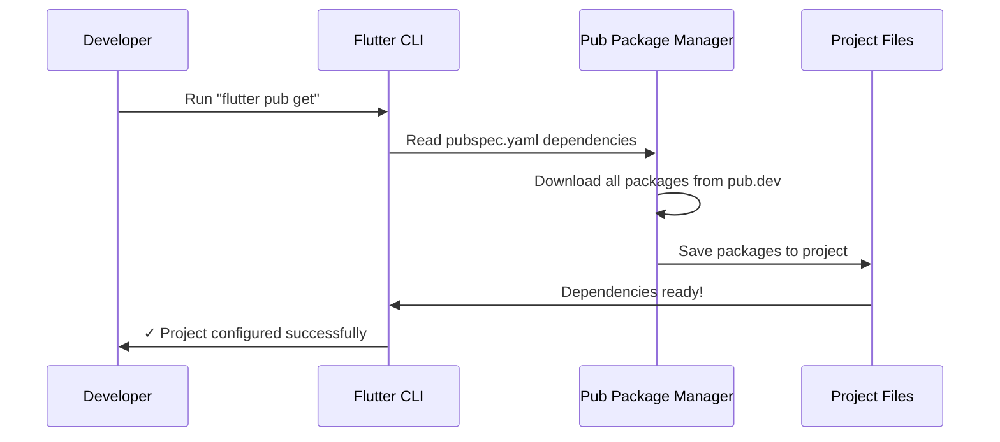

**Step-by-step explanation:**

1. **Developer runs a command**: You type `flutter pub get` in your terminal
2. **Flutter reads the configuration**: It opens `pubspec.yaml` and reads all dependencies
3. **Package manager downloads**: Flutter's package manager (called "Pub") downloads each package from the internet
4. **Packages are saved locally**: All downloaded code is saved in a hidden folder called `packages`
5. **Flutter confirms success**: You see a message like "Got dependencies!"

Now your app can use all those features (GPS, Firebase, phone calls, etc.)!

## Under the Hood: The Dependency Resolution Process

Let's understand what happens when Flutter processes the dependencies:

```yaml
dependencies:
  firebase_core: ^2.15.1
  geolocator: ^10.0.0
```

**What Flutter does internally:**

1. **Reads each dependency line**: "I need firebase_core version 2.15.1 or compatible"
2. **Checks pub.dev**: Connects to Flutter's package repository online
3. **Downloads the package**: Gets the code for firebase_core
4. **Checks nested dependencies**: firebase_core might need OTHER packages! Flutter downloads those too
5. **Resolves version conflicts**: If two packages need different versions of the same dependency, Flutter finds a compatible version that works for both
6. **Creates a lock file**: Saves exact versions in `pubspec.lock` so everyone uses the same versions

**Visual representation:**

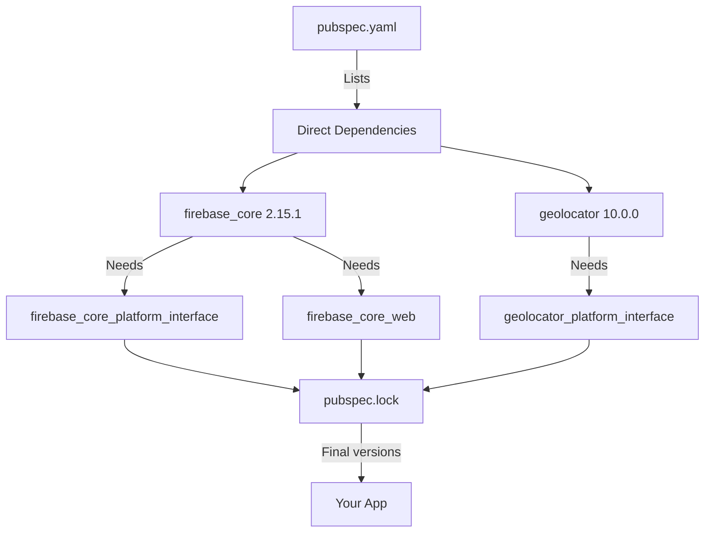

## Real-World Example: Adding a New Feature

Let's say you want to add video recording to the safety app. Here's what you do:

**Step 1**: Find the package on [pub.dev](https://pub.dev)
- Search for "video recording flutter"
- Find a package like `camera`

**Step 2**: Add it to pubspec.yaml
```yaml
dependencies:
  camera: ^0.11.0+1
```

**Step 3**: Save the file and run:
```
flutter pub get
```

**Step 4**: Flutter downloads the camera package and you can now use it in your code!

## Common Sections Reference

Here's a quick reference of what you'll find in pubspec.yaml:

| Section | Purpose | Example |
|---------|---------|---------|
| `name` | App's internal identifier | `women_safety_app` |
| `environment` | Required Dart/Flutter versions | `sdk: '>=3.0.6 <4.0.0'` |
| `dependencies` | Packages your app needs to run | `firebase_core: ^2.15.1` |
| `dev_dependencies` | Tools for development only | `flutter_test:` |
| `assets` | Images, animations, data files | `- assets/` |
| `fonts` | Custom font files | `- family: Montserrat` |

## Why This Matters for the Public Safety App

This safety app needs to do complex things:
- 📍 Track user location in real-time
- 📞 Make emergency calls instantly
- 💾 Store emergency contacts securely
- 📱 Send SMS alerts
- 🗺️ Show maps
- 🔔 Trigger alerts from shake gestures

Without `pubspec.yaml` properly configured with all these dependencies (geolocator, firebase, telephony, etc.), **none of these features would work!** This one file is the foundation that makes everything possible.

## Conclusion

In this chapter, you learned that `pubspec.yaml` is like a master recipe for your Flutter app. It tells Flutter:
- ✅ What external packages to download (dependencies)
- ✅ What versions to use (environment and version constraints)
- ✅ Where to find resources like images and fonts (assets)
- ✅ Basic information about the app (name, version, description)

You now understand how Flutter reads this file, downloads packages, and prepares your project for development. This configuration file is the **starting point** for understanding any Flutter project!

In the next chapter, we'll explore how these packages actually get registered and connected to the native Android and iOS code - a system called [Plugin Registration System](02_plugin_registration_system.md). You'll learn how Flutter bridges the gap between Dart code and native device features like GPS and cameras!


# Chapter 2: Plugin Registration System

## Connecting the Dots from Chapter 1

In [Chapter 1: Flutter Application Configuration](01_flutter_application_configuration.md), we learned that `pubspec.yaml` lists all the packages your app needs - like Firebase, geolocator (GPS), and phone dialing. But here's a critical question: **How does your Dart code actually talk to your phone's GPS hardware or camera?**

Flutter code runs in Dart, which is a cross-platform language. But GPS, cameras, and Firebase run in native code (Java/Kotlin for Android, Swift/Objective-C for iOS, C++ for Windows/Linux). These two worlds speak different languages! We need a translator.

That translator is the **Plugin Registration System**.

## What Problem Does This Solve?

### The Translation Challenge

Imagine you're at an international restaurant. You speak English, but the kitchen staff only speaks Italian. You want to order pizza, but you can't just shout "Pizza!" into the kitchen and expect it to work. You need:

1. **A waiter** who speaks both languages
2. **A menu system** that knows which waiter handles which dishes
3. **Registration** - the restaurant must know this waiter exists and is ready to translate

Similarly, when your Flutter app wants to get GPS location:

```dart
// Your Dart code (English)
Position position = await Geolocator.getCurrentPosition();
```

Behind the scenes, Flutter needs to:
1. Find the **native GPS plugin** (the Italian-speaking kitchen)
2. Use a **registered translator** (the waiter)
3. Get the GPS data from your phone's hardware (the pizza from the kitchen)
4. Return it back to your Dart code

**Without the Plugin Registration System, your Dart code couldn't access ANY hardware features!** It would be like having a menu but no waiters - everything would be stuck.

## Our Central Use Case: Getting GPS Location

Let's trace what happens when the safety app gets your location to send to emergency contacts:

```dart
// In your Dart code
Position position = await Geolocator.getCurrentPosition();
print("Latitude: ${position.latitude}");
```

**The journey this code takes:**

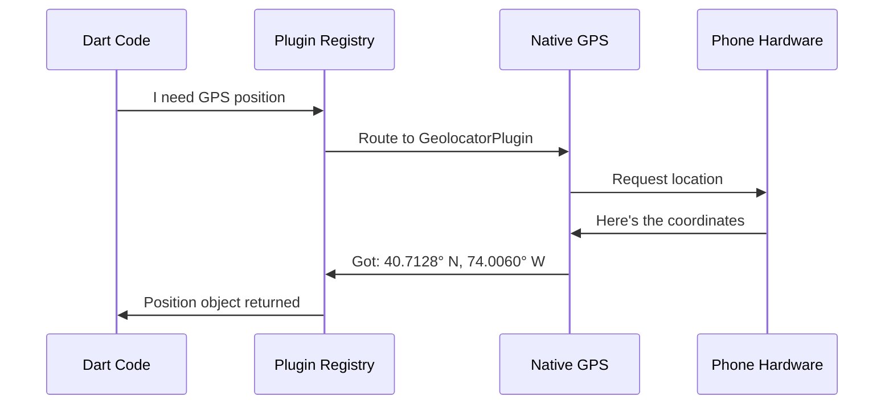

But here's the key question: **How does the Registry know about GeolocatorPlugin?** 

The answer: **Plugin Registration!**

## Key Concept 1: What is a Plugin?

A **plugin** is like a bilingual employee who can translate between Dart and native code.

**Simple breakdown:**
- **Dart side**: Provides easy-to-use functions like `getCurrentPosition()`
- **Native side**: Contains actual code that talks to hardware (GPS, camera, etc.)
- **Bridge**: Connects the two sides

Let's see what plugins our safety app uses. Look at this Windows registration file:

```cpp
#include <geolocator_windows/geolocator_windows.h>
#include <firebase_core/firebase_core_plugin_c_api.h>
#include <cloud_firestore/cloud_firestore_plugin_c_api.h>
```

**What this means:**
- Each `#include` imports a plugin's native code
- `geolocator_windows` - Handles GPS on Windows
- `firebase_core` - Handles Firebase connection
- `cloud_firestore` - Handles Firebase database

Think of these like importing different language dictionaries - each one helps translate different features!

## Key Concept 2: What is Plugin Registration?

**Registration** is the process of telling Flutter: "Hey, these translators are available and ready to work!"

Here's a simplified analogy:

**Before Registration:**
```
Flutter: "I need GPS!"
(silence... no one responds)
```

**After Registration:**
```
Flutter: "I need GPS!"
Geolocator Plugin: "I'm registered! I can help!"
Flutter: "Great, here's the request..."
```

In code, registration looks like this (from Windows):

```cpp
void RegisterPlugins(flutter::PluginRegistry* registry) {
  GeolocatorWindowsRegisterWithRegistrar(
      registry->GetRegistrarForPlugin("GeolocatorWindows"));
}
```

**Breaking this down for beginners:**
- `RegisterPlugins` - The function that registers ALL plugins
- `flutter::PluginRegistry* registry` - The "employee roster" where plugins sign up
- `GeolocatorWindowsRegisterWithRegistrar` - Specifically registers the GPS plugin
- `GetRegistrarForPlugin("GeolocatorWindows")` - Gets a "badge" for this plugin

**Analogy**: This is like the first day of work where the waiter tells the manager: "I'm here, I speak Italian and English, and I'm ready to translate orders!"

## Key Concept 3: Auto-Generation - Flutter Does the Work for You!

Here's something magical: **You never write these registration files yourself!**

Notice at the top of every file:

```cpp
//
//  Generated file. Do not edit.
//
```

**Why auto-generated?**

When you add a plugin to `pubspec.yaml`:

```yaml
dependencies:
  geolocator: ^10.0.0  # You add this
```

And run `flutter pub get`, Flutter automatically:
1. Downloads the geolocator package
2. Reads its configuration
3. **Generates registration code** for every platform (Windows, Linux, Android, iOS)
4. Updates these generated files

**Process visualization:**

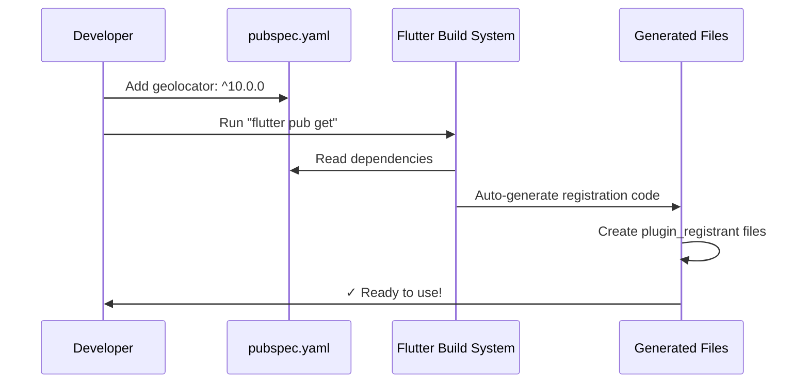

This is like having a robot assistant that automatically updates the restaurant's employee roster whenever someone new is hired!

## Key Concept 4: Platform-Specific Registration

Different operating systems need different code. That's why we have separate registration files:

**Linux Registration** (`linux/flutter/generated_plugin_registrant.cc`):
```cpp
#include <file_selector_linux/file_selector_plugin.h>
#include <url_launcher_linux/url_launcher_plugin.h>

void fl_register_plugins(FlPluginRegistry* registry) {
  file_selector_plugin_register_with_registrar(/*...*/);
  url_launcher_plugin_register_with_registrar(/*...*/);
}
```

**Windows Registration** (`windows/flutter/generated_plugin_registrant.cc`):
```cpp
#include <geolocator_windows/geolocator_windows.h>
#include <firebase_core/firebase_core_plugin_c_api.h>

void RegisterPlugins(flutter::PluginRegistry* registry) {
  GeolocatorWindowsRegisterWithRegistrar(/*...*/);
  FirebaseCorePluginCApiRegisterWithRegistrar(/*...*/);
}
```

**Why different?**
- **Linux uses** `file_selector` and `url_launcher` (no Firebase on desktop in this config)
- **Windows uses** `geolocator`, Firebase, and more

This is like having different staff for different restaurant locations:
- Beach location has a seafood specialist
- Mountain location has a meat specialist
- Each location registers only the specialists it needs!

## How It All Works Together: The Complete Flow

Let's trace what happens from when you start your app to when GPS data arrives:

**Step 1: App Startup**
```cpp
// When your app launches (C++ code on Windows)
void RegisterPlugins(flutter::PluginRegistry* registry) {
  GeolocatorWindowsRegisterWithRegistrar(
      registry->GetRegistrarForPlugin("GeolocatorWindows"));
  FirebaseCorePluginCApiRegisterWithRegistrar(
      registry->GetRegistrarForPlugin("FirebaseCorePluginCApi"));
  // ... more plugins
}
```

**What happens**: Flutter creates a "registry" (like an employee roster) and every plugin signs in.

**Step 2: Dart Code Makes a Request**
```dart
// Your Dart code
Position position = await Geolocator.getCurrentPosition();
```

**What happens**: Dart sends a message: "I need GPS position"

**Step 3: Registry Routes the Request**
```cpp
// Behind the scenes (simplified)
PluginRegistry looks up "Geolocator" -> Finds GeolocatorWindows
Routes message to native code
```

**Step 4: Native Code Executes**
```cpp
// GeolocatorWindows accesses Windows GPS API
// Gets coordinates from hardware
// Returns: Latitude 40.7128, Longitude -74.0060
```

**Step 5: Data Returns to Dart**
```dart
// Your Dart code receives the Position object
print(position.latitude);  // Output: 40.7128
```

**Complete sequence diagram:**

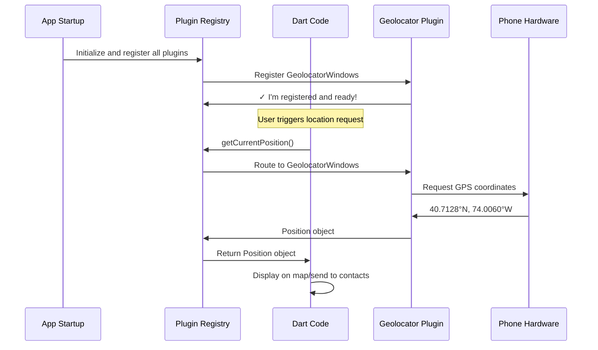

## Under the Hood: The Registration Files

Let's examine the actual structure of these files to understand what Flutter generates:

### The Header File (.h)

```cpp
#ifndef GENERATED_PLUGIN_REGISTRANT_
#define GENERATED_PLUGIN_REGISTRANT_

#include <flutter/plugin_registry.h>

void RegisterPlugins(flutter::PluginRegistry* registry);

#endif
```

**What this does:**
- **Header guards** (`#ifndef`, `#define`, `#endif`) - Prevents duplicate code if included multiple times
- **Declaration** - Announces that a `RegisterPlugins` function exists
- Think of this like a table of contents saying: "There's a registration function on page 5"

### The Implementation File (.cc)

```cpp
#include "generated_plugin_registrant.h"

#include <cloud_firestore/cloud_firestore_plugin_c_api.h>
#include <firebase_core/firebase_core_plugin_c_api.h>
#include <geolocator_windows/geolocator_windows.h>
```

**What this does:**
- **Includes the header** - Links to the declaration
- **Includes plugin headers** - Imports each plugin's native code
- Think of this like gathering all the dictionaries before opening the restaurant

### The Registration Function

```cpp
void RegisterPlugins(flutter::PluginRegistry* registry) {
  CloudFirestorePluginCApiRegisterWithRegistrar(
      registry->GetRegistrarForPlugin("CloudFirestorePluginCApi"));
  
  FirebaseCorePluginCApiRegisterWithRegistrar(
      registry->GetRegistrarForPlugin("FirebaseCorePluginCApi"));
  
  GeolocatorWindowsRegisterWithRegistrar(
      registry->GetRegistrarForPlugin("GeolocatorWindows"));
}
```

**Breaking down one registration:**
```cpp
GeolocatorWindowsRegisterWithRegistrar(
    registry->GetRegistrarForPlugin("GeolocatorWindows")
);
```

**What each part does:**
1. `GeolocatorWindowsRegisterWithRegistrar` - Function from the geolocator plugin that says "register me!"
2. `registry->GetRegistrarForPlugin("GeolocatorWindows")` - Gets a unique "ID badge" for this plugin
3. The function call - Puts the plugin on the roster with its ID badge

**Analogy**: 
- `registry` = The employee roster book
- `GetRegistrarForPlugin` = Creating a new employee badge
- `RegisterWithRegistrar` = The employee signing in with their badge

## Real-World Example: What Happens When You Add a New Plugin

Let's walk through adding the `camera` plugin to see registration in action:

**Step 1: You modify pubspec.yaml**
```yaml
dependencies:
  camera: ^0.11.0  # NEW!
  geolocator: ^10.0.0  # Existing
  firebase_core: ^2.15.1  # Existing
```

**Step 2: You run the command**
```bash
flutter pub get
```

**Step 3: Flutter auto-updates registration files**

Before:
```cpp
void RegisterPlugins(flutter::PluginRegistry* registry) {
  GeolocatorWindowsRegisterWithRegistrar(/*...*/);
  FirebaseCorePluginCApiRegisterWithRegistrar(/*...*/);
}
```

After:
```cpp
void RegisterPlugins(flutter::PluginRegistry* registry) {
  CameraWindowsRegisterWithRegistrar(/*...*/);  // NEW!
  GeolocatorWindowsRegisterWithRegistrar(/*...*/);
  FirebaseCorePluginCApiRegisterWithRegistrar(/*...*/);
}
```

**Step 4: Now you can use the camera in Dart!**
```dart
// This works because CameraPlugin is registered!
final cameras = await availableCameras();
```

**Without registration, this code would crash!** The registry wouldn't know where to route the camera request.

## Comparing Linux vs Windows Registration

Let's see why different platforms need different plugins:

**Linux** (`linux/flutter/generated_plugin_registrant.cc`):
```cpp
#include <file_selector_linux/file_selector_plugin.h>
#include <url_launcher_linux/url_launcher_plugin.h>

void fl_register_plugins(FlPluginRegistry* registry) {
  file_selector_plugin_register_with_registrar(/*...*/);
  url_launcher_plugin_register_with_registrar(/*...*/);
}
```

**Plugins registered**: File selector, URL launcher (only 2 plugins)

**Windows** (`windows/flutter/generated_plugin_registrant.cc`):
```cpp
#include <cloud_firestore/cloud_firestore_plugin_c_api.h>
#include <firebase_auth/firebase_auth_plugin_c_api.h>
#include <firebase_core/firebase_core_plugin_c_api.h>
#include <geolocator_windows/geolocator_windows.h>
// ... more includes

void RegisterPlugins(flutter::PluginRegistry* registry) {
  CloudFirestorePluginCApiRegisterWithRegistrar(/*...*/);
  FirebaseAuthPluginCApiRegisterWithRegistrar(/*...*/);
  FirebaseCorePluginCApiRegisterWithRegistrar(/*...*/);
  GeolocatorWindowsRegisterWithRegistrar(/*...*/);
  // ... more registrations (8 plugins total)
}
```

**Plugins registered**: Firebase services, Geolocator, Permissions, URL launcher, and more

**Why the difference?**
- The safety app is primarily designed for **mobile** (Android/iOS)
- Desktop versions (Linux/Windows) have limited functionality
- Windows has more plugins because some features (like Firebase) work on desktop
- Linux might be used for testing with basic features only

**Analogy**: It's like how a food truck (mobile) has the full menu, but the kiosk version (desktop) only offers drinks and snacks!

## What You Don't Have to Do (Thanks to Auto-Generation!)

Imagine if you had to write registration code manually every time you added a plugin:

**Manual registration (if Flutter didn't auto-generate):**
```cpp
// You'd have to write this yourself - YIKES!
void RegisterPlugins(flutter::PluginRegistry* registry) {
  // Step 1: Figure out the correct include path
  // Step 2: Find the registration function name
  // Step 3: Get the registrar correctly
  // Step 4: Make sure syntax is perfect for each platform
  // Step 5: Repeat for Windows, Linux, Mac, iOS, Android
}
```

**Errors you'd likely make:**
- Misspelling plugin names
- Wrong include paths
- Forgetting to register on one platform
- Syntax errors in C++

**With auto-generation, you just:**
1. Add plugin to `pubspec.yaml`
2. Run `flutter pub get`
3. ✅ Done! Everything works!

This automation saves you hours of frustration!

## The Safety App's Registered Plugins

Let's map out which plugins are registered on Windows and what they enable:

| Plugin | What It Does | Used For in Safety App |
|--------|--------------|----------------------|
| `cloud_firestore` | Firebase database | Store emergency contacts and user data |
| `firebase_auth` | User authentication | Login/logout functionality |
| `firebase_core` | Firebase initialization | Connect to Firebase services |
| `firebase_storage` | File storage | Store user profile pictures |
| `geolocator_windows` | GPS location | Track user location for emergencies |
| `permission_handler_windows` | Request permissions | Ask user for location/camera access |
| `url_launcher_windows` | Open URLs | Open emergency websites |
| `file_selector_windows` | File picker | Select files to upload |

**All of these are registered automatically in the generated file!** Each one becomes available to your Dart code instantly.

## Common Questions Beginners Ask

**Q: Do I ever need to edit these generated files?**
**A:** No! The comment says "Generated file. Do not edit." Flutter regenerates them every time you run `flutter pub get`. Any manual changes would be overwritten.

**Q: What if I remove a plugin from pubspec.yaml?**
**A:** When you run `flutter pub get` again, Flutter automatically removes that plugin's registration from these files. It stays in sync!

**Q: Why do some plugins end in "_windows" or "_linux"?**
**A:** These are platform-specific implementations. For example:
- `geolocator_windows` - GPS for Windows
- `geolocator_android` - GPS for Android (in a different file)
- `geolocator` - The Dart interface that works everywhere

**Q: Can I see these files in my project?**
**A:** Yes! They're in:
- Windows: `windows/flutter/generated_plugin_registrant.cc`
- Linux: `linux/flutter/generated_plugin_registrant.cc`
- Android: `android/app/src/main/java/.../GeneratedPluginRegistrant.java`
- iOS: `ios/Runner/GeneratedPluginRegistrant.m`

## The Big Picture: How Everything Connects

Let's see how this chapter connects to the previous one:

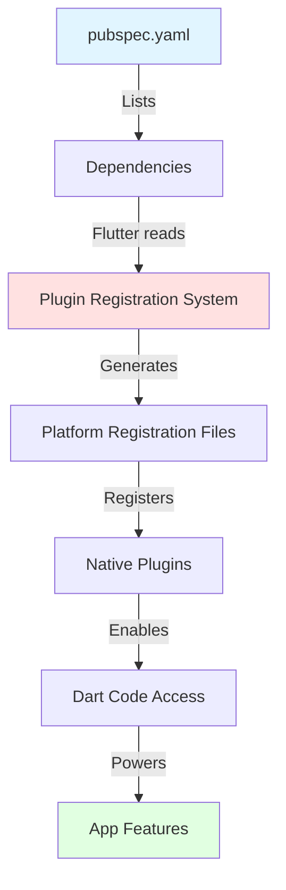

**Step-by-step:**
1. **Chapter 1**: You learned `pubspec.yaml` lists dependencies
2. **Chapter 2**: Flutter reads those dependencies and auto-generates registration code
3. **Next Chapter**: We'll see how these native plugins actually run on each platform!

## Conclusion

In this chapter, you learned that the **Plugin Registration System** is the critical bridge between your Dart code and native device features. Here's what we covered:

✅ **The Problem**: Dart code can't directly access hardware - it needs translators (plugins)

✅ **Plugin Registration**: The process of telling Flutter which plugins are available

✅ **Auto-Generation**: Flutter automatically creates registration files when you run `flutter pub get`

✅ **Platform-Specific**: Different platforms (Windows, Linux, Android, iOS) get different registration files with different plugins

✅ **The Complete Flow**: From app startup → plugin registration → Dart request → native execution → data return

✅ **Real-World Impact**: Without this system, features like GPS, camera, and Firebase wouldn't work at all!

**The key insight**: You never have to think about plugin registration! Just add dependencies to `pubspec.yaml`, and Flutter handles all the complex native code generation behind the scenes. This is one of Flutter's superpowers - making cross-platform development feel effortless.

In the next chapter, [Platform-Specific Native Runners](03_platform_specific_native_runners.md), we'll dive into how your app actually starts up on different platforms and how the native "runners" execute your Flutter code. You'll learn what happens before the first line of your Dart code even runs!

# Chapter 3: Platform-Specific Native Runners

## Building on What We've Learned

In [Chapter 2: Plugin Registration System](02_plugin_registration_system.md), we learned how Flutter plugins get registered so your Dart code can talk to native features like GPS and cameras. But we skipped over a crucial question: **What actually starts your app and makes that registration happen?**

When you click your app's icon or type `flutter run`, something needs to:
- Launch your application
- Create a window on your screen
- Initialize the Flutter engine (the core that runs your Dart code)
- Register all those plugins we talked about
- Start the event loop that keeps your app running

This "something" is called a **Native Runner** - and it's different for every operating system!

## What Problem Does This Solve?

### The Multi-Language Challenge

Here's a fundamental reality: **Flutter is cross-platform, but operating systems are not.**

Think of it like international travel:
- **Your Flutter code** is like you - the same person traveling to different countries
- **Operating systems** are like different countries - each with its own language, customs, and rules
- **Native Runners** are like local guides who speak the native language and help you navigate

Let's see the actual differences:

| Platform | Native Language | What It Uses |
|----------|----------------|--------------|
| **Windows** | C++ | Win32 API (Windows programming interface) |
| **Linux** | C/C++ | GTK (GNOME toolkit for graphical interfaces) |
| **macOS** | Objective-C/Swift | Cocoa framework |
| **Android** | Java/Kotlin | Android SDK |
| **iOS** | Objective-C/Swift | UIKit framework |

**Without platform-specific runners**, Flutter couldn't create windows, handle mouse clicks, or even start running! Each OS expects applications to follow its specific rules.

## Our Central Use Case: Starting the Safety App

Let's trace what happens when someone double-clicks your Public Safety Application on Windows vs. Linux:

**On Windows:**
```
Double-click app icon
    ↓
Windows looks for: main.exe
    ↓
Runs C++ code: wWinMain() function
    ↓
Creates a window using Win32 API
    ↓
Initializes Flutter engine
    ↓
Your Dart code starts running!
```

**On Linux:**
```
Double-click app icon
    ↓
Linux looks for: women_safety_app
    ↓
Runs C code: main() function
    ↓
Creates a window using GTK
    ↓
Initializes Flutter engine
    ↓
Your Dart code starts running!
```

**Same Flutter app, different entry points!** Let's understand how this works.

## Key Concept 1: What is a Native Runner?

A **native runner** is platform-specific code that serves as the "host" for your Flutter application. Think of it like this:

**Analogy**: Running a Play in Different Theaters

Imagine you've written a play (your Flutter app). The script is the same, but to perform it in different cities:

- **New York theater** needs a stage manager who speaks English and knows Broadway rules
- **Paris theater** needs a stage manager who speaks French and knows French theater customs
- **Tokyo theater** needs a stage manager who speaks Japanese and knows Japanese performance traditions

The **play stays the same** (your Dart code), but each theater needs a **local stage manager** (the native runner) to set things up properly!

**What native runners do:**

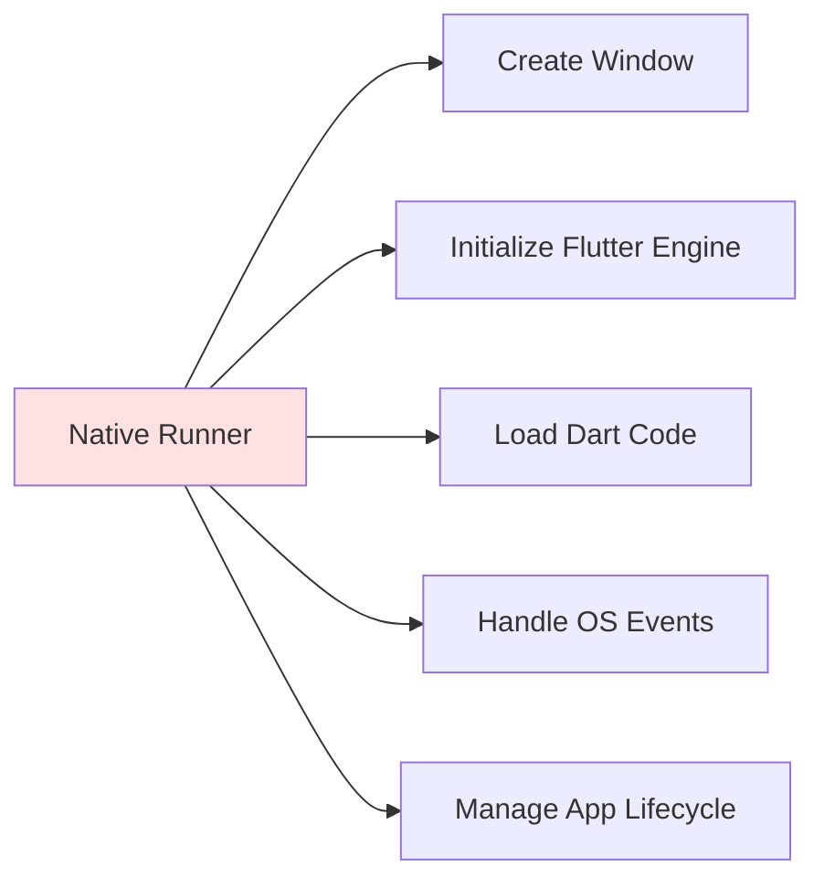

## Key Concept 2: The Entry Point - Where Everything Begins

Every program needs a starting point - a special function that the operating system calls first. This is called the **entry point**.

### Linux Entry Point

```c
// linux/main.cc
int main(int argc, char** argv) {
  g_autoptr(MyApplication) app = my_application_new();
  return g_application_run(G_APPLICATION(app), argc, argv);
}
```

**Breaking this down:**
- `int main()` - The standard entry point for C/Linux programs
- `argc, argv` - Command line arguments (like when you type `./app --debug`)
- `my_application_new()` - Creates our custom application object
- `g_application_run()` - Starts the application and begins the event loop

**Analogy**: This is like the theater's front door opening and the stage manager saying "Let's get this show started!"

### Windows Entry Point

```cpp
// windows/runner/main.cpp
int APIENTRY wWinMain(_In_ HINSTANCE instance,
                      _In_opt_ HINSTANCE prev,
                      _In_ wchar_t *command_line,
                      _In_ int show_command) {
  // Initialize COM
  ::CoInitializeEx(nullptr, COINIT_APARTMENTTHREADED);
  
  flutter::DartProject project(L"data");
  FlutterWindow window(project);
  // ... create window
}
```

**Breaking this down:**
- `wWinMain()` - Windows-specific entry point (not `main()` like Linux!)
- `HINSTANCE instance` - Windows gives us a handle to our program
- `command_line` - Command line arguments (Windows style)
- `CoInitializeEx()` - Initialize Windows COM system (needed for plugins)

**Why different?** Because Windows and Linux are like different countries with different "entry customs"!

## Key Concept 3: Creating the Window

Once the app starts, it needs to create a window where your Flutter UI will appear. This is very platform-specific!

### Linux Window Creation (Using GTK)

```c
// linux/my_application.cc
GtkWindow* window = GTK_WINDOW(
    gtk_application_window_new(GTK_APPLICATION(application))
);
```

**What this does:**
- Uses **GTK** (GNOME Toolkit) - Linux's graphical system
- Creates a window that looks native to Linux/Ubuntu

### Setting Window Properties (Linux)

```c
gtk_window_set_title(window, "women_safety_app");
gtk_window_set_default_size(window, 1280, 720);
gtk_widget_show(GTK_WIDGET(window));
```

**What this does:**
- Sets window title to "women_safety_app"
- Sets default size: 1280 pixels wide, 720 pixels tall
- Makes the window visible on screen

**Analogy**: Like setting up the stage - giving it a name, deciding how big it should be, and opening the curtains!

### Windows Window Creation (Using Win32 API)

```cpp
// windows/runner/main.cpp
FlutterWindow window(project);
Win32Window::Point origin(10, 10);
Win32Window::Size size(1280, 720);

if (!window.Create(L"women_safety_app", origin, size)) {
  return EXIT_FAILURE;
}
```

**What this does:**
- Creates a `FlutterWindow` object (custom class wrapping Win32)
- Sets position: 10 pixels from top-left of screen
- Sets size: 1280x720 pixels
- Creates the actual window using Windows APIs

Notice the same concept (create window, set size) but **completely different code** for each platform!

## Key Concept 4: Initializing the Flutter Engine

Creating a window isn't enough - we need to **put Flutter inside it!** This is where the Flutter engine gets initialized.

### Linux Flutter Initialization

```c
// linux/my_application.cc
g_autoptr(FlDartProject) project = fl_dart_project_new();
FlView* view = fl_view_new(project);

gtk_widget_show(GTK_WIDGET(view));
gtk_container_add(GTK_CONTAINER(window), GTK_WIDGET(view));
```

**What happens step-by-step:**
1. **Create Dart project** - Loads your Dart code configuration
2. **Create Flutter view** - This is the "canvas" where Flutter draws
3. **Show the view** - Make it visible
4. **Add to window** - Put the Flutter view inside the GTK window

**Analogy**: It's like building a TV screen (the view), turning it on, and mounting it inside your room (the window)!

### Windows Flutter Initialization

```cpp
// windows/runner/flutter_window.cpp
flutter_controller_ = std::make_unique<flutter::FlutterViewController>(
    frame.right - frame.left, 
    frame.bottom - frame.top, 
    project_
);

RegisterPlugins(flutter_controller_->engine());
SetChildContent(flutter_controller_->view()->GetNativeWindow());
```

**What happens step-by-step:**
1. **Create Flutter controller** - Manages the Flutter engine
2. **Register plugins** - Remember Chapter 2? This is where it happens!
3. **Set child content** - Embed Flutter view inside Win32 window

Notice: `RegisterPlugins(flutter_controller_->engine())` - **This is the connection to Chapter 2!** The native runner calls the plugin registration we learned about.

## Key Concept 5: The Event Loop - Keeping Your App Alive

Once everything is set up, the app needs to **stay running** and respond to user interactions. This is handled by the **event loop**.

### Windows Event Loop

```cpp
// windows/runner/main.cpp
::MSG msg;
while (::GetMessage(&msg, nullptr, 0, 0)) {
  ::TranslateMessage(&msg);
  ::DispatchMessage(&msg);
}
```

**What this does:**
- **Infinite loop**: Keeps running forever (until you close the app)
- **GetMessage**: Waits for events (mouse clicks, keyboard presses, etc.)
- **TranslateMessage**: Converts low-level events to understandable format
- **DispatchMessage**: Sends events to the appropriate handler

**Analogy**: Like a receptionist at a hotel who continuously:
1. Waits for guests to arrive (GetMessage)
2. Understands their request (TranslateMessage)
3. Directs them to the right room (DispatchMessage)

### Linux Event Loop

```c
// linux/main.cc
return g_application_run(G_APPLICATION(app), argc, argv);
```

**What this does:**
- Linux (GTK) handles the event loop internally!
- `g_application_run()` starts the loop and doesn't return until the app quits
- Much simpler than Windows because GTK abstracts the complexity

**Key difference**: Windows requires manual event loop code, Linux hides it in GTK!

## The Complete Startup Sequence

Let's trace the **entire journey** from double-clicking the app to seeing your Flutter UI:

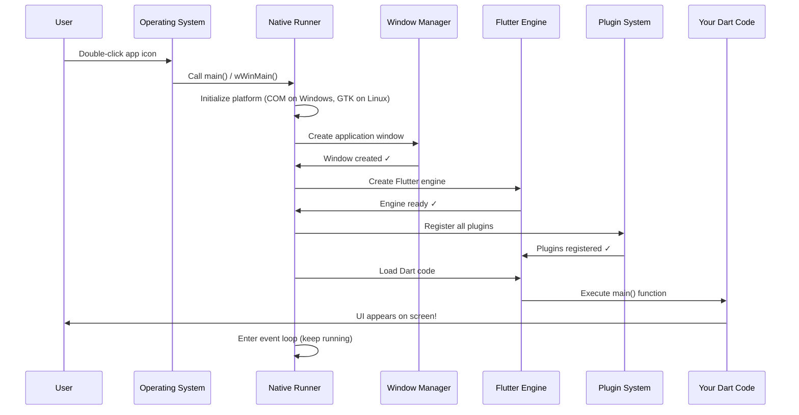

**Step-by-step explanation:**

1. **User action**: Double-click app icon
2. **OS launches**: Calls the platform-specific entry point
3. **Platform initialization**: Set up required systems (COM, GTK)
4. **Window creation**: Create the OS window using native APIs
5. **Engine creation**: Initialize the Flutter engine
6. **Plugin registration**: Register all native plugins (from Chapter 2!)
7. **Dart loading**: Load and start your Flutter/Dart code
8. **UI display**: Your app's UI appears!
9. **Event loop**: Keep running and responding to user interactions

## Under the Hood: Linux Native Runner

Let's dive deeper into how the Linux runner works. The main file is `my_application.cc`:

### Creating the Application Object

```c
struct _MyApplication {
  GtkApplication parent_instance;
  char** dart_entrypoint_arguments;
};

MyApplication* my_application_new() {
  return MY_APPLICATION(g_object_new(
      my_application_get_type(),
      "application-id", APPLICATION_ID,
      nullptr));
}
```

**What this does:**
- Defines a custom application structure
- `GtkApplication parent_instance` - Inherits from GTK's base application
- `dart_entrypoint_arguments` - Stores command line arguments for Dart
- Creates the application with a unique ID

**Analogy**: This is like creating a company (GTK base) and then customizing it for your specific business (Flutter app)!

### Handling Activation (When App Starts)

```c
static void my_application_activate(GApplication* application) {
  MyApplication* self = MY_APPLICATION(application);
  
  GtkWindow* window = GTK_WINDOW(
      gtk_application_window_new(GTK_APPLICATION(application))
  );
  
  gtk_window_set_default_size(window, 1280, 720);
  gtk_widget_show(GTK_WIDGET(window));
}
```

**What happens:**
1. **Called by GTK** when the app is activated
2. **Create window** using GTK
3. **Set size** to 1280x720
4. **Show window** on screen

### Creating the Flutter View

```c
g_autoptr(FlDartProject) project = fl_dart_project_new();
fl_dart_project_set_dart_entrypoint_arguments(
    project, 
    self->dart_entrypoint_arguments
);

FlView* view = fl_view_new(project);
gtk_container_add(GTK_CONTAINER(window), GTK_WIDGET(view));
```

**What happens:**
1. **Create Dart project** - Configures where Dart code lives
2. **Pass arguments** - Like `--debug` or `--release`
3. **Create Flutter view** - The rendering surface
4. **Add to window** - Embed Flutter inside GTK window

### Registering Plugins (The Connection!)

```c
fl_register_plugins(FL_PLUGIN_REGISTRY(view));
```

**This is it!** This single line calls the plugin registration we learned in [Chapter 2: Plugin Registration System](02_plugin_registration_system.md)!

Remember the auto-generated file `generated_plugin_registrant.cc`? This is where it gets called!

## Under the Hood: Windows Native Runner

Windows is more complex because it uses lower-level APIs. Let's break it down:

### Windows Entry Point

```cpp
int APIENTRY wWinMain(_In_ HINSTANCE instance,
                      _In_opt_ HINSTANCE prev,
                      _In_ wchar_t *command_line,
                      _In_ int show_command) {
  
  // Initialize COM
  ::CoInitializeEx(nullptr, COINIT_APARTMENTTHREADED);
  
  flutter::DartProject project(L"data");
  // ... continues
}
```

**What happens:**
1. **wWinMain**: Windows-specific entry (requires `APIENTRY` calling convention)
2. **CoInitializeEx**: Initializes COM (Component Object Model) - needed for many Windows features and plugins
3. **DartProject**: Creates Flutter project pointing to "data" folder (where your app's files are)

**Why COM?** Many Windows plugins (like file pickers, notifications) use COM. Without initializing it, they'd crash!

### Creating the Flutter Window

```cpp
FlutterWindow window(project);
Win32Window::Point origin(10, 10);
Win32Window::Size size(1280, 720);

if (!window.Create(L"women_safety_app", origin, size)) {
  return EXIT_FAILURE;
}

window.SetQuitOnClose(true);
```

**What happens:**
1. **Create FlutterWindow object** - Custom class that wraps Win32 window
2. **Set position** - 10 pixels from top-left
3. **Set size** - 1280x720 pixels
4. **Create**: Actually creates the Win32 window
5. **SetQuitOnClose**: App exits when window closes

### The Window Creation Process

```cpp
// windows/runner/flutter_window.cpp
bool FlutterWindow::OnCreate() {
  if (!Win32Window::OnCreate()) {
    return false;
  }
  
  RECT frame = GetClientArea();
  
  flutter_controller_ = std::make_unique<flutter::FlutterViewController>(
      frame.right - frame.left, 
      frame.bottom - frame.top, 
      project_
  );
}
```

**What happens:**
1. **Call base class** - Let Win32Window do basic setup
2. **Get client area** - Get the drawable area inside the window
3. **Create FlutterViewController** - This initializes the Flutter engine!

### Plugin Registration (Windows)

```cpp
RegisterPlugins(flutter_controller_->engine());
```

**Here it is again!** Same concept as Linux, different platform:
- Gets the Flutter engine
- Calls the registration function from [Chapter 2: Plugin Registration System](02_plugin_registration_system.md)
- All plugins (Firebase, Geolocator, etc.) become available

### The Windows Event Loop

```cpp
::MSG msg;
while (::GetMessage(&msg, nullptr, 0, 0)) {
  ::TranslateMessage(&msg);
  ::DispatchMessage(&msg);
}

::CoUninitialize();
return EXIT_SUCCESS;
```

**What happens:**
1. **Declare message structure** - Holds event data
2. **GetMessage loop** - Waits for events (blocks until one arrives)
3. **TranslateMessage** - Converts keyboard events
4. **DispatchMessage** - Sends event to the window
5. **CoUninitialize** - Clean up COM when app exits
6. **Return success** - Tell Windows we exited cleanly

**Visual representation:**

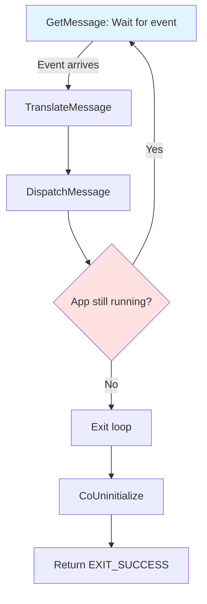

## Platform Comparison: Linux vs Windows

Let's compare the two platforms side-by-side:

| Aspect | Linux | Windows |
|--------|-------|---------|
| **Entry Point** | `main(argc, argv)` | `wWinMain(instance, ...)` |
| **GUI Framework** | GTK (GNOME Toolkit) | Win32 API |
| **Window Creation** | `gtk_application_window_new()` | Custom Win32Window class |
| **Event Loop** | Handled by GTK internally | Manual GetMessage loop |
| **Initialization** | GTK auto-handles much complexity | Must initialize COM manually |
| **Code Complexity** | ~200 lines | ~400 lines |
| **Philosophy** | High-level toolkit approach | Low-level API approach |

**Key insight**: Both do the same job (create window, run Flutter), but use completely different approaches matching their platform's philosophy!

## Real-World Example: What Happens When You Click a Button

Let's trace a click through the entire system:

**You click a button in your Flutter app:**

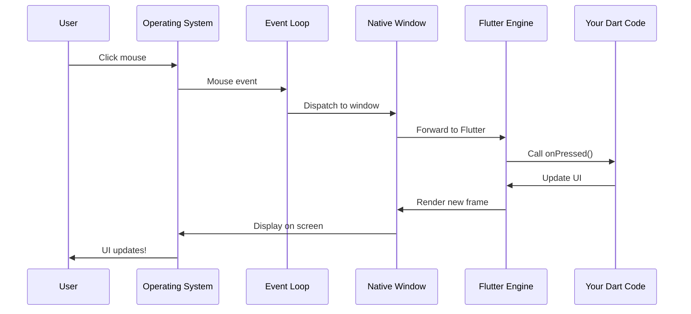

**Step-by-step:**
1. **Physical click**: Your finger presses the mouse button
2. **OS detects**: Operating system captures the hardware event
3. **Event loop**: Native runner's event loop receives it
4. **Window handler**: Native window determines it was inside the app
5. **Flutter engine**: Converts to Flutter's coordinate system
6. **Dart code**: Your `onPressed()` function runs!
7. **UI update**: Dart code updates the UI state
8. **Rendering**: Flutter engine renders the new UI
9. **Display**: Native window shows the updated pixels

**This is where native runners shine** - they bridge your clicks to your Dart code seamlessly!

## Why This Architecture Matters for Cross-Platform

Here's the beautiful part: **You write your UI once in Dart, and these native runners adapt it to each platform automatically!**

**Your Dart code** (same everywhere):
```dart
ElevatedButton(
  onPressed: () {
    print('Emergency button pressed!');
  },
  child: Text('CALL HELP'),
)
```

**What happens behind the scenes:**

| Platform | Native Runner Does |
|----------|-------------------|
| **Windows** | Creates Win32 window → Renders button using Skia → Handles Win32 mouse events |
| **Linux** | Creates GTK window → Renders button using Skia → Handles GTK events |
| **Android** | Creates Activity → Renders button using Skia → Handles touch events |
| **iOS** | Creates UIViewController → Renders button using Metal → Handles touch events |

**The magic**: Your Dart code doesn't know or care! The native runner handles all platform-specific details.

## Common Files in Native Runners

### Linux Files

```
linux/
├── main.cc                     # Entry point
├── my_application.cc           # Application logic
└── flutter/
    └── generated_plugin_registrant.cc  # From Chapter 2!
```

**Roles:**
- `main.cc` - Launches the app
- `my_application.cc` - Creates window, initializes Flutter
- `generated_plugin_registrant.cc` - Registers plugins

### Windows Files

```
windows/runner/
├── main.cpp                    # Entry point
├── flutter_window.cpp          # Flutter window wrapper
├── win32_window.cpp            # Base Win32 window
└── flutter/
    └── generated_plugin_registrant.cc  # From Chapter 2!
```

**Roles:**
- `main.cpp` - Entry point and event loop
- `flutter_window.cpp` - Integrates Flutter engine
- `win32_window.cpp` - Handles Win32 window creation
- `generated_plugin_registrant.cc` - Registers plugins

## Connecting All Three Chapters

Let's see how everything we've learned fits together:

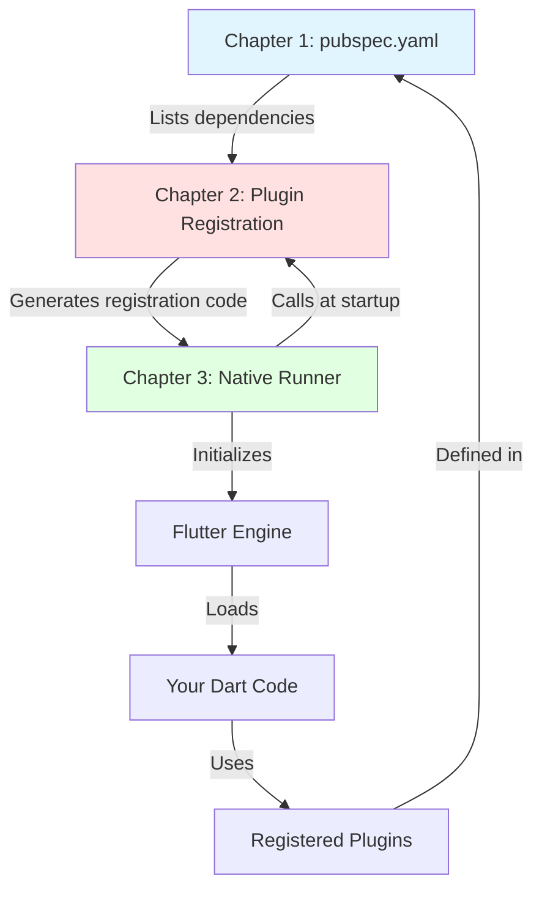

**The complete story:**

1. **[Chapter 1: Flutter Application Configuration](01_flutter_application_configuration.md)**: You list dependencies in `pubspec.yaml`
   
2. **[Chapter 2: Plugin Registration System](02_plugin_registration_system.md)**: Flutter auto-generates registration code for all plugins

3. **Chapter 3: Platform-Specific Native Runners**: The native runner:
   - Starts the app
   - Creates the window
   - Initializes Flutter engine
   - **Calls the plugin registration code**
   - Loads your Dart code
   - Enters the event loop

**Everything connects!** Without native runners, the plugin registration would never get called, and your Dart code would never run!

## Why You (Usually) Don't Edit These Files

You might notice these files have complex C++ code. Here's the good news: **You almost never need to modify them!**

**Flutter manages native runners for you:**
- ✅ Auto-generated structure
- ✅ Auto-updates when you add plugins
- ✅ Platform-specific code already written
- ✅ Tested and maintained by Flutter team

**When you might edit them:**
- Adding custom native functionality
- Integrating with platform-specific APIs
- Advanced customization (rare!)

For 95% of apps, including this safety app, the default native runners work perfectly!

## Conclusion

In this chapter, you learned that **Platform-Specific Native Runners** are the essential bridge between operating systems and your Flutter app. Here's what we covered:

✅ **The Problem**: Different operating systems require different native code to launch apps

✅ **Entry Points**: Each platform has its own way to start programs (`main()` on Linux, `wWinMain()` on Windows)

✅ **Window Creation**: Native runners create OS-specific windows (GTK for Linux, Win32 for Windows)

✅ **Flutter Initialization**: They set up the Flutter engine inside those windows

✅ **Plugin Registration**: They call the plugin registration system from [Chapter 2: Plugin Registration System](02_plugin_registration_system.md)

✅ **Event Loops**: They keep the app running and responsive to user interactions

✅ **Cross-Platform Magic**: Same Dart code runs everywhere because native runners adapt to each platform

**The key insight**: Native runners are like translators and stage managers - they speak the native language of each operating system and set everything up so your Flutter code can run seamlessly across all platforms!

You now understand the complete foundation of a Flutter app:
- **Configuration** ([Chapter 1](01_flutter_application_configuration.md))
- **Plugin System** ([Chapter 2](02_plugin_registration_system.md))  
- **Native Runners** (this chapter)

With this knowledge, you can confidently explore any Flutter project and understand how it comes to life on different platforms! The safety app we've been studying uses all three layers to provide critical features like GPS tracking and emergency calling across Windows, Linux, Android, and iOS - all from a single codebase.

