# Chapter 1: Flutter Cross-Platform Application Architecture

## What Problem Does This Solve?

Imagine you've built an amazing emergency alert app called SafeGuard. You want it to work on your friend's Android phone, your Windows laptop, and a police officer's iPad - all without rewriting the entire app three times!

This is exactly what **Flutter's Cross-Platform Architecture** solves. You write your app code once in Flutter/Dart, and it runs everywhere. But here's the catch: each operating system (Windows, Linux, Android, iOS) speaks a different "language." Windows wants `.exe` files, Linux wants executables, and mobile devices have their own requirements.

**The central question**: If Flutter lets us write once and run anywhere, why do we still have platform-specific files in our SafeGuard project?

Let's explore this through a practical example!

## The Universal Adapter Analogy

Think of your Flutter app like a universal phone charger. The charger itself (your Flutter/Dart code) is the same everywhere, but each country needs a different plug adapter:

- 🔌 **US plug** = Windows entry point
- 🔌 **UK plug** = Linux entry point  
- 🔌 **EU plug** = Android entry point
- 🔌 **AU plug** = iOS entry point

The **adapter** doesn't change how your charger works internally - it just helps the charger connect to the wall socket (the operating system).

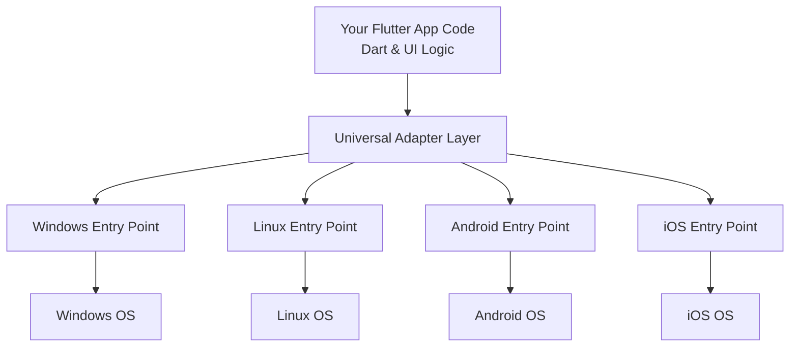

## Key Concepts Breakdown

### 1. The Single Codebase (Your App's Brain)

Your main app logic lives in Dart files. This is where SafeGuard's emergency alert system, location tracking, and UI are defined. This code is **100% shared** across all platforms.

```dart
// This same code runs on ALL platforms
void sendEmergencyAlert() {
  // Get location
  // Send to Firebase
  // Notify police
}
```

**What happens**: This Dart code works identically whether running on Windows, Linux, or mobile devices.

### 2. Platform Entry Points (The Adapters)

Each operating system needs a special "starting file" that knows how to:
- Create a window (on desktop) or screen (on mobile)
- Load the Flutter engine
- Tell the OS "Hey, there's an app here!"

Think of these as the "ignition keys" - different for each car, but they all start the engine.

### 3. The Flutter Engine (The Universal Translator)

The Flutter engine is like a translator that sits between your Dart code and the operating system. It:
- Renders your UI
- Handles touch/mouse input
- Communicates with the OS

You never write engine code yourself - Flutter provides it!

## How It Works: Starting SafeGuard on Different Platforms

Let's see what happens when someone launches SafeGuard on **Windows** vs **Linux**.

### Starting on Windows

When you double-click `SafeGuard.exe` on Windows:

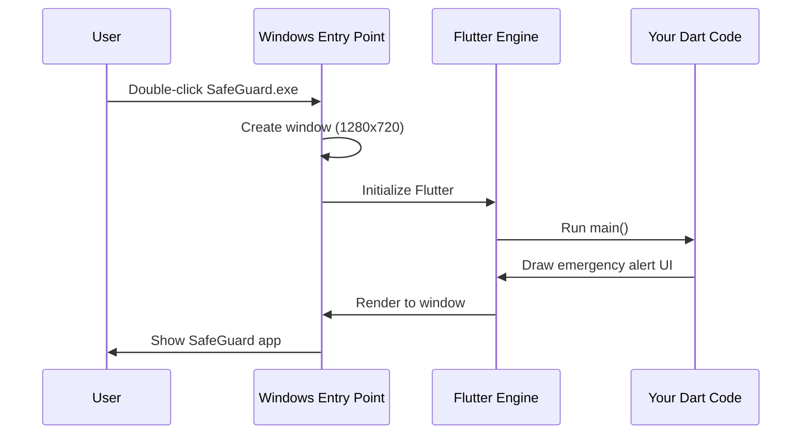

**Step-by-step**:
1. Windows runs `main.cpp` (the Windows entry point)
2. The entry point creates a window
3. It initializes the Flutter engine
4. The engine runs your Dart code
5. Your UI appears on screen!

### Starting on Linux

The Linux process is nearly identical, but uses Linux-specific code:

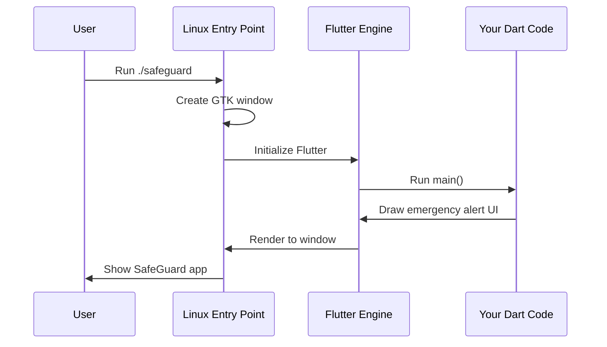

**The magic**: Notice how steps 3-5 are identical! Only the first two steps differ because Windows and Linux create windows differently.

## Internal Implementation: Looking Under the Hood

Now let's peek at the actual code to understand how these entry points work.

### Windows Entry Point

The Windows version starts in `windows/runner/main.cpp`:

```cpp
int APIENTRY wWinMain(/* Windows parameters */) {
  // Initialize Windows COM
  ::CoInitializeEx(nullptr, COINIT_APARTMENTTHREADED);
  
  flutter::DartProject project(L"data");
```

**What's happening**: 
- `wWinMain` is the function Windows calls when you start the app
- `CoInitializeEx` prepares Windows for the app
- `DartProject` tells Flutter where your Dart code lives (in the "data" folder)

Next, it creates the window:

```cpp
  FlutterWindow window(project);
  Win32Window::Size size(1280, 720);
  
  window.Create(L"women_safety_app", origin, size);
  window.SetQuitOnClose(true);
```

**What's happening**:
- Creates a `FlutterWindow` object
- Sets the window size to 1280×720 pixels
- `Create()` actually makes the window appear
- When you close this window, the app quits

Finally, it starts the Windows message loop:

```cpp
  ::MSG msg;
  while (::GetMessage(&msg, nullptr, 0, 0)) {
    ::TranslateMessage(&msg);
    ::DispatchMessage(&msg);
  }
```

**What's happening**: This loop keeps the app running, listening for mouse clicks, keyboard input, and window events.

### Linux Entry Point

The Linux version starts in `linux/main.cc`:

```cpp
int main(int argc, char** argv) {
  g_autoptr(MyApplication) app = my_application_new();
  return g_application_run(G_APPLICATION(app), argc, argv);
}
```

**What's happening**:
- `main` is the standard Linux starting point
- Creates a custom `MyApplication` object
- `g_application_run` starts the GTK application loop (similar to Windows message loop)

The real work happens in `linux/my_application.cc`:

```cpp
static void my_application_activate(GApplication* application) {
  GtkWindow* window = GTK_WINDOW(
    gtk_application_window_new(GTK_APPLICATION(application))
  );
  
  gtk_window_set_default_size(window, 1280, 720);
```

**What's happening**:
- `gtk_application_window_new` creates a GTK window (Linux's windowing system)
- Sets the same 1280×720 size as Windows

Then it initializes Flutter:

```cpp
  g_autoptr(FlDartProject) project = fl_dart_project_new();
  FlView* view = fl_view_new(project);
  
  gtk_container_add(GTK_CONTAINER(window), GTK_WIDGET(view));
```

**What's happening**:
- Creates a Flutter Dart project object
- Creates a Flutter view (where your UI renders)
- Adds the Flutter view to the GTK window

### The Common Pattern

Notice the pattern across both platforms:

1. **Create a window** (platform-specific)
2. **Initialize Flutter engine** (uses Flutter's cross-platform API)
3. **Start event loop** (platform-specific)

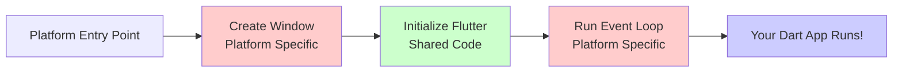

**Legend**: Red = platform-specific code, Green = shared Flutter code, Blue = your app code

## Why This Architecture Matters for SafeGuard

For the SafeGuard emergency alert app, this architecture means:

1. **Write once**: The emergency alert logic, location tracking, and Firebase integration are written once in Dart
2. **Run anywhere**: Police officers can use Windows desktops, citizens can use Android phones
3. **Native performance**: Each platform uses native window creation for fast, smooth performance
4. **Easy maintenance**: Bug fixes in Dart code automatically apply to all platforms

When you update the emergency alert feature, you change one Dart file, and it works on all four platforms!

## Conclusion

You've learned that Flutter's cross-platform architecture works like a universal adapter:

- **Your Dart code** is the universal charger (same everywhere)
- **Platform entry points** are the plug adapters (different for each OS)
- **Flutter engine** is the translator between them

Each platform (Windows, Linux, Android, iOS) has a small entry point file that creates a window, initializes Flutter, and starts the app loop. After that, your shared Dart code takes over and runs identically everywhere.

In the next chapter, [Plugin Registration & Native Integration System](02_plugin_registration___native_integration_system.md), we'll explore how Flutter plugins allow your app to access platform-specific features like GPS, cameras, and sensors - essential for SafeGuard's location tracking!


# Chapter 2: Plugin Registration & Native Integration System

In [Chapter 1: Flutter Cross-Platform Application Architecture](01_flutter_cross_platform_application_architecture.md), you learned how Flutter creates platform-specific entry points that all run your shared Dart code. But here's a new challenge: what happens when your Dart code needs to do something that only the native platform can do, like accessing GPS or sending SMS messages?

Let's explore how SafeGuard bridges this gap!

## What Problem Does This Solve?

Imagine you're coding SafeGuard's emergency alert feature. You need to:

1. **Get the user's GPS location** - to send to emergency responders
2. **Access Firebase** - to store alerts in the cloud
3. **Use the camera** - to capture evidence photos
4. **Send SMS messages** - to notify emergency contacts

Here's the problem: **Dart can't do any of these things by itself!**

Why? Because GPS, cameras, and SMS are hardware features controlled by the operating system (Windows, Linux, Android). Dart is a programming language that runs in a protected environment and doesn't have direct access to hardware.

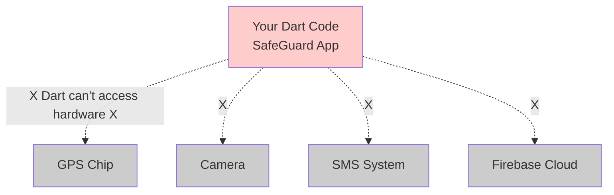

**The solution**: Plugins! They act as bridges between your Dart code and native platform code.

## The Telephone Switchboard Analogy

Think of the plugin registration system like an old-fashioned telephone switchboard from the 1950s:

- **Your Dart code** is like someone making phone calls
- **Each plugin** is like a phone line to a specific service (GPS line, Camera line, SMS line)
- **The plugin registrant** is like the switchboard operator who connects all the lines when the app starts

Before you can make calls, the operator must plug in all the cables to connect your phone to the services. Similarly, before your Dart code can use GPS or Firebase, the plugin registration system must "plug in" all the plugins!

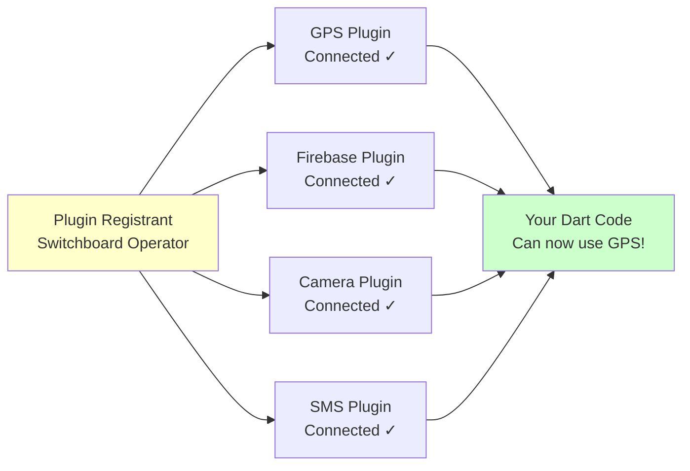

## Key Concepts Breakdown

### 1. What Are Plugins?

A **plugin** is a package that contains:
- **Dart code** that your app calls (the easy part you write)
- **Native code** (C++, Java, Kotlin, Swift) that talks to the operating system

Think of it like a translator:

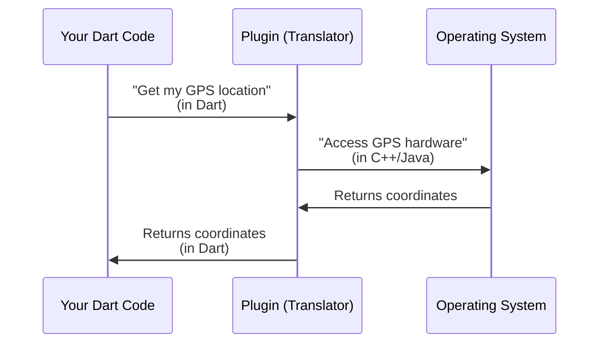

### 2. What Is Plugin Registration?

**Registration** means telling Flutter: "Hey, these plugins exist and here's how to use them."

When SafeGuard starts, before your Dart code runs, the plugin registrant:
1. Creates a list of all available plugins
2. Tells each plugin: "Get ready! The app might need you soon"
3. Sets up communication channels between Dart and native code

It's like installing drivers on your computer - each plugin is a "driver" for a specific feature.

### 3. Native vs. Dart Code

Let's understand this critical distinction:

| **Dart Code** | **Native Code** |
|---------------|-----------------|
| Written in Dart language | Written in C++, Java, Kotlin, or Swift |
| Runs in Flutter's virtual machine | Runs directly on the operating system |
| Can't access hardware | Can access GPS, camera, etc. |
| Same on all platforms | Different for each platform |

**Example**: When SafeGuard gets GPS location:
- Your **Dart code** says: "I need location"
- The **plugin** translates this to native code
- **Native code** asks Windows/Linux/Android for GPS data
- The **plugin** translates the response back to Dart

## How Plugin Registration Works

Let's see what happens when SafeGuard starts on Windows.

### The Registration Process

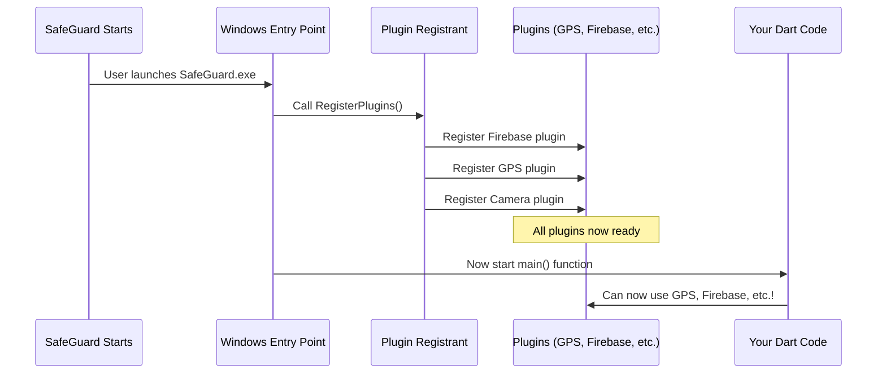

**Step-by-step**:
1. User launches SafeGuard
2. Windows entry point starts (remember from Chapter 1)
3. **Before running your Dart code**, the entry point calls `RegisterPlugins()`
4. The plugin registrant registers each plugin one-by-one
5. Only then does your Dart `main()` function run
6. Your code can now use plugins!

### The Critical Timing

This is why registration happens **before** your app code runs:

```dart
// ❌ This would crash without plugin registration
void main() {
  getGPSLocation();  // ERROR! GPS plugin not registered yet!
}
```

But with registration:

```dart
// ✅ This works because plugins are registered first
void main() {
  // Plugin registrant already ran before this
  getGPSLocation();  // Works perfectly!
}
```

## Internal Implementation: Looking at the Code

Now let's examine the actual plugin registration code for Windows and Linux.

### Windows Plugin Registration

The Windows entry point calls the plugin registrant in `windows/runner/main.cpp`:

```cpp
// Inside the main() function
#include "flutter/generated_plugin_registrant.h"

RegisterPlugins(flutter_controller);
```

**What's happening**: 
- Includes the auto-generated registrant header file
- Calls `RegisterPlugins()` to register all Windows plugins
- Passes `flutter_controller` which manages the Flutter engine

Now let's see what `RegisterPlugins()` actually does. Open `windows/flutter/generated_plugin_registrant.cc`:

```cpp
#include "generated_plugin_registrant.h"

#include <cloud_firestore/cloud_firestore_plugin_c_api.h>
#include <firebase_auth/firebase_auth_plugin_c_api.h>
#include <firebase_core/firebase_core_plugin_c_api.h>
```

**What's happening**: Each `#include` loads a different plugin's native code. These are the "phone lines" being prepared!

Here's the registration function:

```cpp
void RegisterPlugins(flutter::PluginRegistry* registry) {
  CloudFirestorePluginCApiRegisterWithRegistrar(
      registry->GetRegistrarForPlugin("CloudFirestorePluginCApi"));
```

**What's happening**:
- `registry` is like a phonebook of available plugins
- `GetRegistrarForPlugin()` finds the "phone number" for this plugin
- `CloudFirestorePluginCApiRegisterWithRegistrar()` "connects the line"

Let's see more plugins being registered:

```cpp
  FirebaseAuthPluginCApiRegisterWithRegistrar(
      registry->GetRegistrarForPlugin("FirebaseAuthPluginCApi"));
  GeolocatorWindowsRegisterWithRegistrar(
      registry->GetRegistrarForPlugin("GeolocatorWindows"));
```

**What's happening**: 
- Firebase Auth plugin registered (for user login)
- Geolocator plugin registered (for GPS tracking!)

Notice the pattern? Every plugin follows the same steps:
1. Get a registrar from the registry
2. Call the plugin's registration function
3. The plugin sets up its communication channel

### Linux Plugin Registration

Linux works almost identically! In `linux/flutter/generated_plugin_registrant.cc`:

```cpp
#include "generated_plugin_registrant.h"

#include <file_selector_linux/file_selector_plugin.h>
#include <url_launcher_linux/url_launcher_plugin.h>
```

**What's happening**: Linux includes different plugins (file selector, URL launcher) because it needs different native features than Windows.

The registration function:

```cpp
void fl_register_plugins(FlPluginRegistry* registry) {
  g_autoptr(FlPluginRegistrar) file_selector_linux_registrar =
      fl_plugin_registry_get_registrar_for_plugin(
          registry, "FileSelectorPlugin");
  file_selector_plugin_register_with_registrar(
      file_selector_linux_registrar);
```

**What's happening**:
- `fl_plugin_registry_get_registrar_for_plugin()` gets the registrar (like Windows)
- `file_selector_plugin_register_with_registrar()` registers the plugin
- Same pattern, different platform!

### The Auto-Generated Magic

Notice these comments at the top of both files:

```cpp
//
//  Generated file. Do not edit.
//
```

**What this means**: You never write these files manually! When you add a plugin to your `pubspec.yaml` file (we'll learn about this in [Chapter 3: Dependency & Configuration Management](03_dependency___configuration_management.md)), Flutter automatically:

1. Reads which plugins you need
2. Generates the registration code
3. Includes all necessary headers
4. Creates the registration functions

It's like having an assistant who automatically updates the switchboard whenever you add a new phone line!

### Understanding the Header Files

The header files (`.h` files) are like instruction manuals that tell other code what functions are available.

Windows header (`windows/flutter/generated_plugin_registrant.h`):

```cpp
#ifndef GENERATED_PLUGIN_REGISTRANT_
#define GENERATED_PLUGIN_REGISTRANT_

#include <flutter/plugin_registry.h>

void RegisterPlugins(flutter::PluginRegistry* registry);
```

**What's happening**:
- Declares the `RegisterPlugins()` function
- Other files can now "see" and call this function
- The `#ifndef` guards prevent double-inclusion

Linux header (`linux/flutter/generated_plugin_registrant.h`):

```cpp
#ifndef GENERATED_PLUGIN_REGISTRANT_
#define GENERATED_PLUGIN_REGISTRANT_

#include <flutter_linux/flutter_linux.h>

void fl_register_plugins(FlPluginRegistry* registry);
```

**What's happening**: Same purpose, but uses Linux's Flutter library (`flutter_linux.h`) instead of generic Flutter.

## Why This Matters for SafeGuard

Let's connect this back to SafeGuard's emergency features:

### Before Plugin Registration

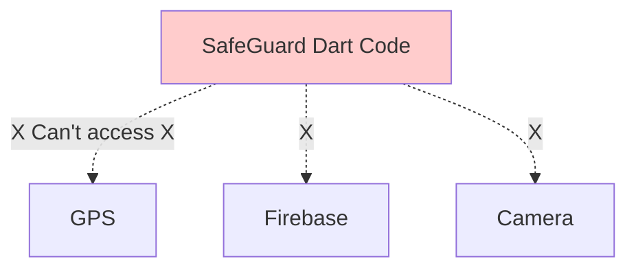

### After Plugin Registration

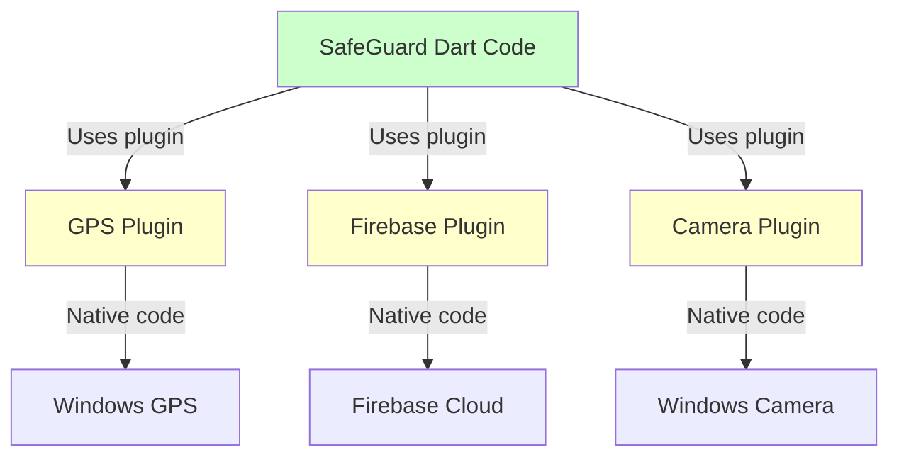

### Real-World Example

When a user presses SafeGuard's emergency button:

```dart
// Your Dart code (cross-platform)
Future<void> sendEmergencyAlert() async {
  // 1. Get location using geolocator plugin
  Position location = await Geolocator.getCurrentPosition();
  
  // 2. Save to Firebase using firestore plugin
  await FirebaseFirestore.instance.collection('alerts').add({
    'latitude': location.latitude,
    'longitude': location.longitude,
    'timestamp': DateTime.now(),
  });
}
```

**Behind the scenes**:
1. `Geolocator.getCurrentPosition()` uses the registered GPS plugin
2. The plugin's native code accesses Windows/Linux GPS hardware
3. `FirebaseFirestore.instance` uses the registered Firebase plugin
4. That plugin's native code connects to Firebase servers
5. All of this works because `RegisterPlugins()` set everything up!

### Different Plugins for Different Platforms

Notice how Windows has more Firebase plugins than Linux:

**Windows plugins**:
- `cloud_firestore` - Database
- `firebase_auth` - Authentication
- `firebase_core` - Core services
- `firebase_storage` - File storage
- `geolocator_windows` - GPS

**Linux plugins**:
- `file_selector_linux` - File picker
- `url_launcher_linux` - Open URLs

**Why the difference?** Different platforms have different capabilities and different common use cases. Desktop apps might focus on file selection, while mobile apps need GPS and push notifications.

## How Plugins Communicate: Method Channels

You might wonder: how exactly does Dart code "call" native C++ code? The answer is **method channels**.

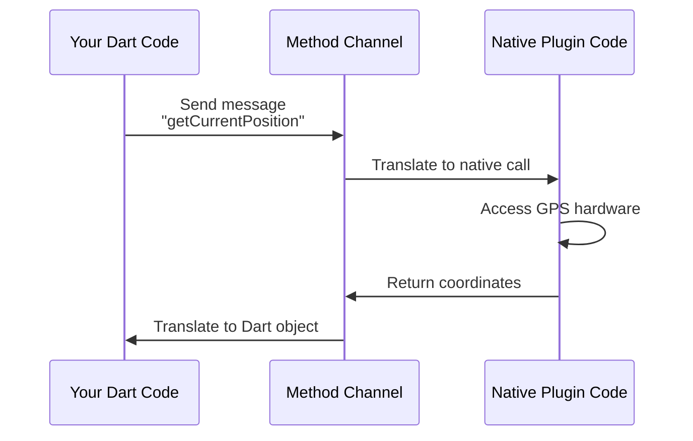

Think of method channels like a language translator at the United Nations:
- You speak English (Dart)
- The translator converts to French (native code)
- The French speaker responds
- The translator converts back to English

The plugin registration system sets up these translators (channels) so communication can happen instantly when needed!

## Conclusion

You've learned how the Plugin Registration & Native Integration System works like a telephone switchboard:

- **Plugins** are bridges connecting Dart code to native platform features
- **Plugin registrants** automatically register all plugins when SafeGuard starts
- **Registration happens first**, before your app code runs, so plugins are ready to use
- Each platform (Windows, Linux) has its own auto-generated registrant with platform-specific plugins
- This system enables SafeGuard to access GPS, Firebase, cameras, and other hardware features

The beauty of this system is that it's **completely automatic**. You just add plugins to your project, and Flutter generates all the registration code for you!

In the next chapter, [Dependency & Configuration Management](03_dependency___configuration_management.md), you'll learn how to actually add new plugins to SafeGuard and configure them - the missing piece that controls which plugins get registered!


# Chapter 3: Dependency & Configuration Management

In [Chapter 2: Plugin Registration & Native Integration System](02_plugin_registration___native_integration_system.md), you learned how plugins bridge the gap between your Dart code and native platform features like GPS and cameras. But here's a question that might be nagging at you: **How did those plugins get into your project in the first place?**

Let's solve this mystery by exploring the files that act as your project's "shopping list" and "quality inspector"!

## What Problem Does This Solve?

Imagine you're adding a new feature to SafeGuard: **video evidence recording**. You need to:

1. **Add a video player plugin** - to preview recorded videos
2. **Include new fonts** - to make the video UI look professional  
3. **Import image assets** - for video recording button icons
4. **Ensure code quality** - so the new code follows best practices

Here's the challenge: **How does Flutter know which plugins you need? Where do you tell it to include fonts and images?**

You could manually:
- Download each plugin's code from the internet
- Copy files into your project folders
- Configure each plugin individually
- Hope everyone on your team does it exactly the same way

This would be a nightmare! Different team members would have different versions, some might forget plugins, and chaos would ensue.

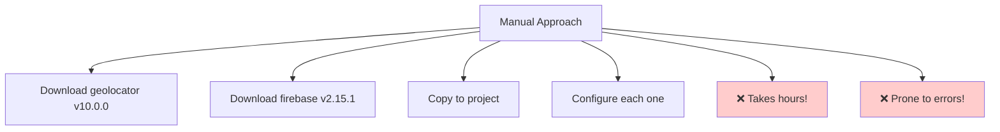

**The solution**: Two special configuration files that automate everything!

## The Shopping List & Recipe Book Analogy

Think of building SafeGuard like cooking a complex dish:

**pubspec.yaml** is your shopping list and recipe:
- **Dependencies section** = Ingredients you need (plugins like `geolocator`, `firebase_core`)
- **Version numbers** = Specific brands/quantities ("flour v2.0", not just "flour")
- **Assets section** = Where you keep your tools (images, fonts)
- **Environment section** = Required kitchen equipment (Dart SDK version)

**analysis_options.yaml** is your quality inspector:
- Checks if you're following the recipe correctly
- Warns you about food safety issues (code quality problems)
- Ensures consistency across all cooks (all developers)

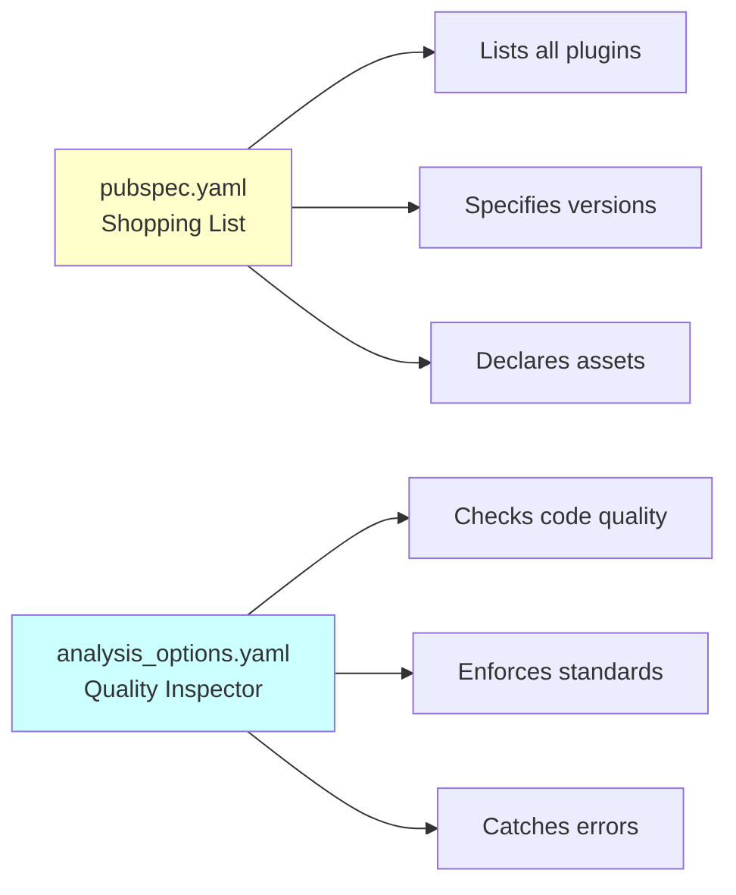

When you run `flutter pub get`, Flutter reads your shopping list, goes to the "store" (pub.dev), and automatically downloads everything!

## Key Concepts Breakdown

### 1. Dependencies: Your Project's Ingredients

A **dependency** is an external package that your app needs to function. SafeGuard uses many:

- `geolocator` - Gets GPS location
- `firebase_core` - Connects to Firebase
- `camera` - Accesses device camera
- `google_maps_flutter` - Shows maps

Think of each dependency like a pre-made ingredient. Instead of baking bread from scratch, you buy bread from the store. Instead of coding GPS from scratch, you use the `geolocator` package!

### 2. Version Constraints: Preventing Spoiled Ingredients

Version numbers prevent compatibility issues:

```yaml
geolocator: ^10.0.0
```

The `^` symbol means: "Use version 10.0.0 or any compatible newer version (like 10.1.0), but NOT version 11.0.0 (which might break things)."

It's like saying: "I need eggs version 1.0 (chicken eggs), not eggs version 2.0 (ostrich eggs) - they won't work in my recipe!"

### 3. Dev Dependencies: Tools, Not Ingredients

Some packages are only needed during development, not in the final app:

```yaml
dev_dependencies:
  flutter_test:  # For writing tests
  build_runner:  # For generating code
```

These are like kitchen tools (mixers, measuring cups) - you need them to cook, but they don't go into the food itself!

### 4. Assets: Your Project's Media Files

Assets are images, fonts, and other files bundled with your app:

```yaml
assets:
  - assets/
  - lib/res/png/
```

This tells Flutter: "Include all files from these folders when building the app."

### 5. Lints: Your Code Quality Rules

The `analysis_options.yaml` file defines rules that check your code:

```yaml
include: package:flutter_lints/flutter.yaml
```

This imports Flutter's recommended code quality rules - like a health inspector's checklist for your code!

## Understanding pubspec.yaml: The Shopping List

Let's walk through SafeGuard's actual `pubspec.yaml` file section by section.

### Project Metadata

At the very top:

```yaml
name: women_safety_app
description: A new Flutter project.
publish_to: 'none'
```

**What this means**:
- `name` - Your project's unique identifier (like a product barcode)
- `description` - Human-readable summary
- `publish_to: 'none'` - Don't accidentally publish this private app to pub.dev (the public package store)

### Version Information

```yaml
version: 1.0.0+1
```

**What this means**: 
- `1.0.0` = Version shown to users (major.minor.patch)
- `+1` = Build number (for internal tracking)

When you release an update, you'd change this to `1.0.1+2`.

### SDK Constraints

```yaml
environment:
  sdk: '>=3.0.6 <4.0.0'
```

**What this means**: This app requires Dart SDK version 3.0.6 or newer, but NOT version 4.0.0 (which might introduce breaking changes).

It's like saying: "This recipe needs a modern oven (v3+), but we haven't tested it with the brand-new experimental oven (v4)."

### The Dependencies Section

Here's where the magic happens! Let's look at some key plugins:

```yaml
dependencies:
  flutter:
    sdk: flutter
  
  cupertino_icons: ^1.0.2
  firebase_core: ^2.15.1
  geolocator: ^10.0.0
  camera: ^0.11.0+1
```

**What's happening**:
- `flutter: sdk: flutter` - Use Flutter framework (required for all apps)
- `cupertino_icons: ^1.0.2` - iOS-style icons
- `firebase_core: ^2.15.1` - Firebase basics (version 2.15.1 or compatible)
- `geolocator: ^10.0.0` - GPS plugin (remember from Chapter 2!)
- `camera: ^0.11.0+1` - Camera access

Each line is like an item on your shopping list: "Get geolocator, any 10.x version will do."

### More Complex Dependencies

SafeGuard uses many more plugins:

```yaml
  google_maps_flutter:
  location: ^6.0.2
  firebase_storage: ^11.2.6
  image_picker: ^1.0.4
```

**What's happening**:
- `google_maps_flutter` (no version) - Use latest compatible version
- `location: ^6.0.2` - Location tracking
- `firebase_storage: ^11.2.6` - Store files in Firebase
- `image_picker: ^1.0.4` - Choose images from device

Notice the pattern? Just list what you need, and Flutter handles the rest!

### Dev Dependencies

```yaml
dev_dependencies:
  flutter_test:
    sdk: flutter
  build_runner: ^2.4.6
  flutter_lints: ^2.0.0
```

**What's happening**:
- `flutter_test` - Testing framework (only for development)
- `build_runner` - Generates code (used with some plugins)
- `flutter_lints` - Code quality checker

These packages help you BUILD the app but don't end up IN the app.

### Assets Configuration

```yaml
flutter:
  uses-material-design: true
  
  assets:
    - assets/
    - lib/res/png/
    - lib/res/lottie/
```

**What's happening**:
- `uses-material-design: true` - Include Material Design icons
- `assets:` - List of folders containing images, animations, etc.
- `assets/` - Include everything in the `assets` folder
- `lib/res/png/` - Include PNG images
- `lib/res/lottie/` - Include Lottie animations

This tells Flutter: "When building the app, bundle these files so the app can access them."

### Fonts Configuration

```yaml
  fonts:
    - family: Montserrat
      fonts:
        - asset: lib/res/fonts/Montserrat/Montserrat-Regular.ttf
        - asset: lib/res/fonts/Montserrat/Montserrat-Bold.ttf
          weight: 700
```

**What's happening**:
- Defines a custom font family called "Montserrat"
- Lists different font files for different weights
- `weight: 700` means this file is used for bold text

Now your Dart code can use:

```dart
Text('Emergency Alert', 
  style: TextStyle(fontFamily: 'Montserrat', fontWeight: FontWeight.bold)
)
```

## Understanding analysis_options.yaml: The Quality Inspector

This file defines code quality rules. Let's examine SafeGuard's configuration:

```yaml
include: package:flutter_lints/flutter.yaml
```

**What this means**: Import Flutter's recommended set of code quality rules. This is like saying "Use the standard health inspection checklist."

The imported rules check for things like:
- Unused variables
- Missing type annotations
- Inconsistent naming
- Potential bugs

### The Linter Section

```yaml
linter:
  rules:
    # avoid_print: false  # Uncomment to disable
    # prefer_single_quotes: true  # Uncomment to enable
```

**What's happening**:
- You can customize rules here
- Commented lines show examples
- `avoid_print: false` would allow `print()` statements (normally discouraged)
- `prefer_single_quotes: true` would enforce single quotes instead of double

### How It Helps You

When you write code, your IDE (like VS Code or Android Studio) shows warnings:

```dart
// ❌ Warning: Unused variable
void sendAlert() {
  String message = "Help!";  // Yellow underline - unused variable!
  // Oops, forgot to send it!
}

// ✅ Fixed
void sendAlert() {
  String message = "Help!";
  sendToServer(message);  // Now it's used!
}
```

The analyzer catches these issues BEFORE you run the app - saving you debugging time!

## How to Add a New Dependency: Step-by-Step

Let's add a new feature to SafeGuard: **video playback**. We need the `video_player` plugin.

### Step 1: Find the Package

Visit [pub.dev](https://pub.dev) and search for "video_player". You'll see:
- Package name: `video_player`
- Latest version: `2.9.1`

### Step 2: Add to pubspec.yaml

Open `pubspec.yaml` and add the dependency:

```yaml
dependencies:
  flutter:
    sdk: flutter
  
  camera: ^0.11.0+1
  video_player: ^2.9.1  # Add this line!
```

**What you did**: Added `video_player` to your shopping list with version 2.9.1 or compatible.

### Step 3: Run Flutter Pub Get

In your terminal, run:

```bash
flutter pub get
```

**What happens**: 
1. Flutter reads your pubspec.yaml
2. Downloads `video_player` from pub.dev
3. Downloads any dependencies that `video_player` needs
4. Updates plugin registration (connects to Chapter 2!)
5. Updates your project's lock file

You'll see output like:

```
Running "flutter pub get" in women_safety_app...
Resolving dependencies...
+ video_player 2.9.1
+ video_player_platform_interface 6.0.0
+ video_player_web 2.1.0
Changed 3 dependencies!
```

### Step 4: Use the Plugin

Now you can import and use it:

```dart
import 'package:video_player/video_player.dart';

void playEvidence() {
  VideoPlayerController controller = 
    VideoPlayerController.asset('videos/evidence.mp4');
  controller.play();
}
```

**That's it!** Four simple steps to add any plugin to your project.

## What Happens Internally: The Pub Get Process

Let's see what happens when you run `flutter pub get`:

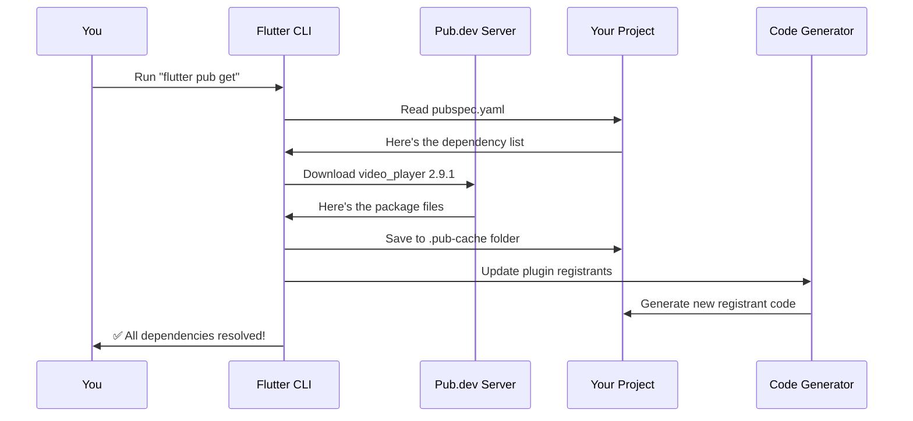

**Step-by-step**:

1. **Read pubspec.yaml**: Flutter reads your shopping list
2. **Check cache**: Have we already downloaded this version?
3. **Download packages**: If not, fetch from pub.dev
4. **Resolve dependencies**: If `video_player` needs other packages, download those too
5. **Save to cache**: Store in `.pub-cache` folder (global storage)
6. **Generate code**: Update plugin registrants (from Chapter 2!)
7. **Create pubspec.lock**: Lock file with exact versions used

### The Lock File

After `pub get`, a new file appears: `pubspec.lock`. This contains the EXACT versions downloaded:

```yaml
video_player:
  dependency: "direct main"
  description:
    name: video_player
    url: "https://pub.dartlang.org"
  source: hosted
  version: "2.9.1"
```

**Why it matters**: If you specified `^2.9.1` (meaning "2.9.1 or compatible"), the lock file records that you got exactly `2.9.1`. This ensures everyone on your team gets the same version!

### Connecting to Plugin Registration

Remember the auto-generated plugin registrants from [Chapter 2: Plugin Registration & Native Integration System](02_plugin_registration___native_integration_system.md)? They update automatically!

When you add `video_player` to pubspec.yaml and run `pub get`, Flutter:

1. Detects you added a new plugin
2. Checks which platforms it supports (Android, iOS, Windows, etc.)
3. Updates `generated_plugin_registrant.cc` on each platform
4. Adds registration code for `video_player`

**Before adding video_player** (Windows registrant):

```cpp
void RegisterPlugins(flutter::PluginRegistry* registry) {
  GeolocatorWindowsRegisterWithRegistrar(
      registry->GetRegistrarForPlugin("GeolocatorWindows"));
  // Other plugins...
}
```

**After adding video_player** (Windows registrant):

```cpp
void RegisterPlugins(flutter::PluginRegistry* registry) {
  GeolocatorWindowsRegisterWithRegistrar(
      registry->GetRegistrarForPlugin("GeolocatorWindows"));
  VideoPlayerWindowsRegisterWithRegistrar(
      registry->GetRegistrarForPlugin("VideoPlayerWindows"));  // NEW!
  // Other plugins...
}
```

**The magic**: This happens automatically! You never edit these files manually.

## How the Analyzer Works: Code Quality Checks

When you save a Dart file, the analyzer springs into action:

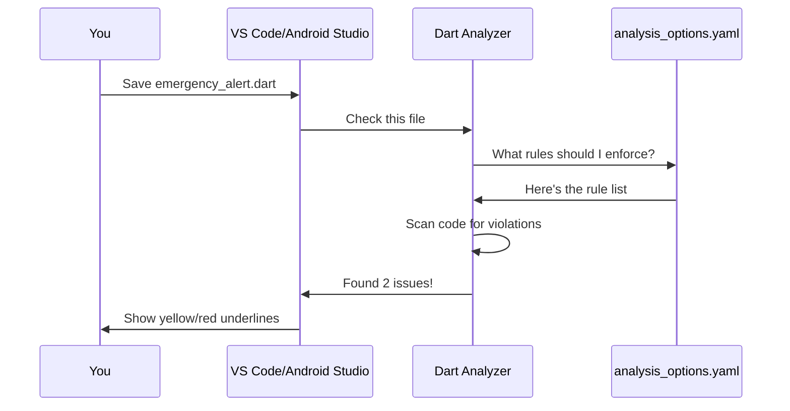

### Example: Catching Errors

Let's say you write this code:

```dart
void sendAlert() {
  String emergencyMessage = 'Help needed!';
  int unusedCounter = 0;  // Never used
  
  FirebaseFirestore.instance
    .collection('alerts')
    .add({'message': emergencyMessage});
}
```

**What the analyzer does**:
1. Reads `analysis_options.yaml` for rules
2. Finds rule: "Warn about unused variables"
3. Scans your code
4. Detects `unusedCounter` is never used
5. Shows a yellow warning in your IDE

You see:

```dart
int unusedCounter = 0;  // ⚠️ The value of 'unusedCounter' isn't used
```

This helps you catch bugs early!

### Customizing Rules

You can enable/disable specific rules:

```yaml
linter:
  rules:
    avoid_print: false  # Allow print statements
    prefer_single_quotes: true  # Enforce 'text' over "text"
    avoid_unnecessary_containers: true  # Warn about redundant widgets
```

Now the analyzer enforces YOUR team's style preferences!

## Real-World Example: Adding Map Markers

Let's add a complete new feature to SafeGuard using dependency management.

**Goal**: Show emergency alerts on a map with custom markers.

### Step 1: Add Dependencies

Edit `pubspec.yaml`:

```yaml
dependencies:
  google_maps_flutter: ^2.5.0  # Already in SafeGuard
  geolocator: ^10.0.0          # Already in SafeGuard
  custom_marker_maker: ^1.0.0  # NEW! Custom map pins
```

### Step 2: Add Marker Assets

Add marker images to `assets/markers/`:

```
assets/
  markers/
    police_marker.png
    alert_marker.png
```

Update `pubspec.yaml`:

```yaml
flutter:
  assets:
    - assets/
    - assets/markers/  # Add this!
```

### Step 3: Run Pub Get

```bash
flutter pub get
```

**Output**:
```
Resolving dependencies...
+ custom_marker_maker 1.0.0
Changed 1 dependency!
```

### Step 4: Use in Code

Now you can use everything:

```dart
import 'package:google_maps_flutter/google_maps_flutter.dart';
import 'package:custom_marker_maker/custom_marker_maker.dart';

void showAlertsOnMap() async {
  // Custom marker uses the asset we added
  BitmapDescriptor customIcon = await BitmapDescriptor.fromAssetImage(
    ImageConfiguration(),
    'assets/markers/alert_marker.png',  // From assets!
  );
  
  // Create marker
  Marker alertMarker = Marker(
    markerId: MarkerId('alert1'),
    position: LatLng(37.7749, -122.4194),
    icon: customIcon,  // Uses custom_marker_maker plugin!
  );
}
```

**What happened**:
1. `pubspec.yaml` declared the dependencies and assets
2. `flutter pub get` downloaded plugins and updated registrants
3. Assets were bundled into the app
4. Your code can now use both plugins and assets seamlessly!

## Version Conflicts: When Shopping Lists Clash

Sometimes two plugins need different versions of the same dependency:

```yaml
# Your pubspec.yaml
plugin_a: ^1.0.0  # Needs http ^0.13.0
plugin_b: ^2.0.0  # Needs http ^0.14.0
```

**The problem**: Both can't coexist! It's like needing two different brands of the same ingredient.

**Flutter's solution**: Shows an error:

```
Because plugin_a requires http ^0.13.0 and plugin_b requires http ^0.14.0,
version solving failed.
```

**How to fix**:
1. Update plugins to compatible versions
2. Find alternative plugins
3. Wait for plugin authors to update

This is why the lock file and version constraints are so important!

## Common pubspec.yaml Mistakes

### Mistake 1: Wrong Indentation

```yaml
# ❌ Wrong
dependencies:
flutter:
  sdk: flutter

# ✅ Correct
dependencies:
  flutter:
    sdk: flutter
```

**Why it matters**: YAML uses indentation like Python. Wrong spacing = broken file!

### Mistake 2: Missing Quotes

```yaml
# ❌ Wrong (special characters need quotes)
name: women's_app

# ✅ Correct
name: "women's_app"
```

### Mistake 3: Forgetting Pub Get

```yaml
# Added new dependency but forgot to run pub get
dependencies:
  new_plugin: ^1.0.0
```

```dart
import 'package:new_plugin/new_plugin.dart';  // ❌ Error: Package not found!
```

**Solution**: Always run `flutter pub get` after editing pubspec.yaml!

## Conclusion

You've learned how Dependency & Configuration Management works like a shopping list and quality inspector:

- **pubspec.yaml** is your project's shopping list that declares all dependencies, assets, fonts, and configurations
- **Dependencies** are external packages your app needs, automatically downloaded from pub.dev
- **Version constraints** prevent compatibility issues by specifying acceptable version ranges
- **Assets and fonts** are bundled into your app by listing them in pubspec.yaml
- **analysis_options.yaml** enforces code quality rules to catch errors early
- **flutter pub get** reads your shopping list, downloads packages, and updates plugin registrants (connecting to [Chapter 2: Plugin Registration & Native Integration System](02_plugin_registration___native_integration_system.md)!)

These two files work together to ensure that:
- Everyone on your team uses the same plugin versions
- All necessary assets are included
- Code quality stays consistent
- Plugin registration happens automatically

Now you understand the complete picture! Your `pubspec.yaml` declares what plugins you need, `flutter pub get` downloads them, and the auto-generated plugin registrants (from Chapter 2) make them available to your Dart code. The `analysis_options.yaml` keeps your code clean throughout the entire process.

With this knowledge, you can confidently add new features to SafeGuard, manage dependencies professionally, and maintain high code quality - all through two simple configuration files!

