# Chapter 1: Flutter Cross-Platform Framework

## The Problem: Building Apps for Every Device

Imagine you want to create a safety app called SafeGuard that helps people send emergency alerts to nearby police officers. You want everyone to use it, whether they have an Android phone, an iPhone, a Windows laptop, or a Linux computer.

Traditionally, you'd have to build **four separate apps**:
- One in Java or Kotlin for Android
- One in Swift for iOS  
- One in C# for Windows
- One in C++ for Linux

That's like writing the same book in four different languages! You'd need different developers, different codebases, and four times the work every time you want to add a feature or fix a bug.

**This is the problem Flutter solves.**

## What is Flutter?

Flutter is like a **universal translator** for apps. You write your app once in a language called Dart, and Flutter automatically translates it so it works on Android, iOS, Windows, Linux, and even the web!

Think of it this way:

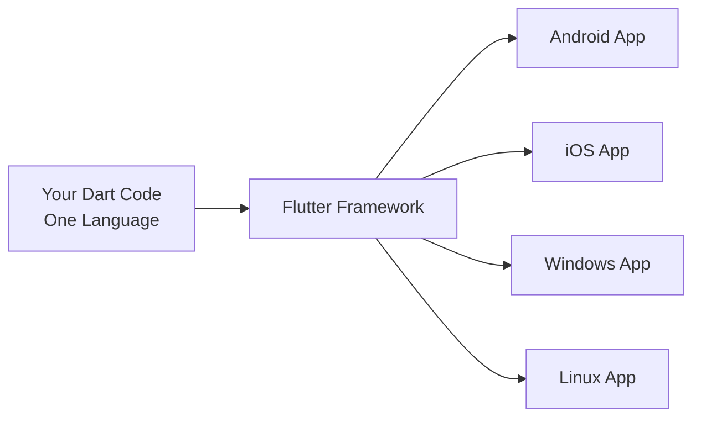

You write once, and Flutter makes it work everywhere. This is called **cross-platform development**.

## How SafeGuard Uses Flutter

Let's look at how the SafeGuard app is structured. When you download the project, you'll see folders like this:

```
Public_Safety_Application/
├── lib/              ← Your main app code (Dart)
├── android/          ← Android-specific bridge code
├── ios/              ← iOS-specific bridge code  
├── windows/          ← Windows-specific bridge code
├── linux/            ← Linux-specific bridge code
└── pubspec.yaml      ← Project configuration
```

The `lib/` folder contains your app logic written in Dart - things like emergency alert buttons, GPS tracking, and user interfaces. This code is **the same for all platforms**.

The `android/`, `ios/`, `windows/`, and `linux/` folders contain small "bridge" programs that connect your Dart code to each operating system's unique features.

## The Bridge Concept

Let's understand what these platform folders do with a simple analogy.

Imagine you're at an international conference and you want to say "Help!" to people who speak different languages:

- **Your message** = Your Dart code (the emergency alert feature)
- **Flutter** = The conference's translation system
- **Platform bridges** = Human interpreters for each language

Here's what happens:

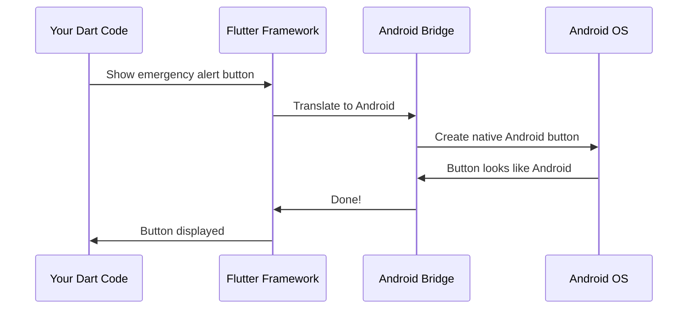

When your Dart code says "show a button," Flutter tells the Android bridge, and the bridge creates a button that looks and feels like a real Android button. The same process happens on iOS, Windows, and Linux - each bridge creates a native-looking button for that platform.

## Looking at a Platform Bridge

Let's peek at the Windows bridge code to see what this "translation" looks like. Here's a simplified version from `windows/runner/main.cpp`:

```cpp
#include <flutter/dart_project.h>
#include <windows.h>

int main() {
  flutter::DartProject project(L"data");
  
  FlutterWindow window(project);
  window.Create(L"women_safety_app");
```

**What's happening here?**

1. Line 1-2: Include Flutter's tools and Windows system tools
2. Line 4: Start the program (every program needs a starting point)
3. Line 5: Tell Flutter where to find your Dart code
4. Line 7-8: Create a Windows window to display your app

This is C++ code (not Dart) because Windows speaks C++. This small bridge program launches your Flutter app inside a Windows window. Your Dart code runs inside this window, and the bridge translates requests back and forth.

The Linux bridge (`linux/main.cc`) looks similar but uses Linux's language:

```cpp
#include "my_application.h"

int main(int argc, char** argv) {
  g_autoptr(MyApplication) app = my_application_new();
  return g_application_run(G_APPLICATION(app), argc, argv);
}
```

Same idea, different platform language! It creates a Linux application window and runs your Flutter app inside it.

## Your Dart Code: One Codebase for All

Now let's see what YOUR code looks like. In the `lib/` folder, you write Dart code like this:

```dart
// This shows a simple emergency button
ElevatedButton(
  onPressed: () {
    sendEmergencyAlert();
  },
  child: Text('EMERGENCY'),
)
```

**Example output:** On every platform, this creates a red emergency button. When clicked, it calls the `sendEmergencyAlert()` function.

- On Android: It looks like a Material Design button
- On iOS: It looks like a Cupertino (iOS-style) button
- On Windows/Linux: It looks like a desktop button

Same code, but Flutter makes it look native on each platform!

## The Configuration File: pubspec.yaml

The `pubspec.yaml` file tells Flutter what your app needs. Let's look at a snippet:

```yaml
name: women_safety_app
description: A new Flutter project.

environment:
  sdk: '>=3.0.6 <4.0.0'

dependencies:
  flutter:
    sdk: flutter
  geolocator: ^10.0.0
  firebase_core: ^2.15.1
```

**What does this mean?**

- `name`: Your app's internal name
- `environment`: Which version of Dart you're using
- `dependencies`: Extra packages (like GPS tracking and Firebase)

Think of dependencies as add-ons. Just like you install apps on your phone, Flutter apps can install packages. The `geolocator` package gives you GPS features, and `firebase_core` connects you to Firebase (we'll learn about that in [Chapter 2: Firebase Backend Services](02_firebase_backend_services.md)).

## How Flutter Builds Your App

When you tell Flutter to build your app, here's what happens behind the scenes:

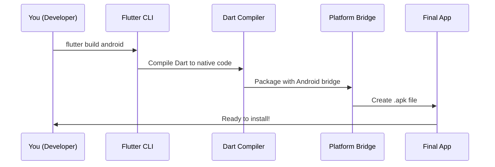

**Step-by-step:**

1. You run a command like `flutter build android`
2. Flutter compiles your Dart code into machine code
3. It packages this with the Android bridge code
4. It creates an `.apk` file (an Android app)
5. You can install this on any Android phone!

For Windows, you'd run `flutter build windows` and get a `.exe` file instead. Same Dart code, different package!

## Why This Matters for SafeGuard

The SafeGuard app needs to:
- Track GPS location in real-time
- Show maps
- Send emergency alerts
- Work on phones and computers

With Flutter, developers wrote these features **once** in Dart. The GPS tracking code looks like this:

```dart
// Get current location
Position position = await Geolocator.getCurrentPosition();
print('Latitude: ${position.latitude}');
print('Longitude: ${position.longitude}');
```

**Example output:**
```
Latitude: 37.7749
Longitude: -122.4194
```

This code works identically on Android, iOS, Windows, and Linux! The `geolocator` package uses Flutter's platform channels to talk to each operating system's GPS system.

## Platform Channels: The Translation Phone Line

Sometimes your Dart code needs to do something very specific to one platform, like making a phone call on Android. Flutter uses **platform channels** - think of them as phone lines between your Dart code and native code.

Here's a simplified diagram:

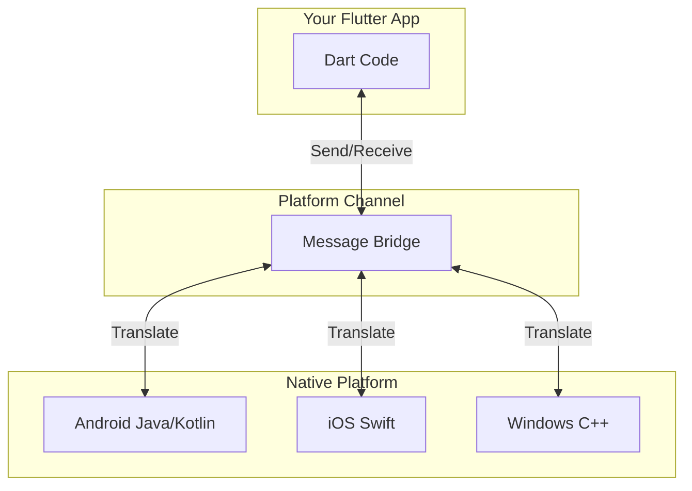

When SafeGuard needs to make an emergency call, your Dart code sends a message through the channel, and the native platform code (like Android's Java) actually dials the number.

## What You've Learned

In this chapter, you discovered:

1. **The Problem**: Building separate apps for each platform is time-consuming and expensive
2. **The Solution**: Flutter lets you write once in Dart and run everywhere
3. **Platform Bridges**: Small native programs that connect your Dart code to each operating system
4. **Single Codebase**: All your app logic lives in the `lib/` folder as Dart code
5. **Platform Folders**: `android/`, `ios/`, `windows/`, and `linux/` contain bridge code that translates your app to native features

Flutter is the foundation that makes SafeGuard possible. It's why a single team could build an app that works on Android phones, iPhones, Windows PCs, and Linux machines without writing four separate apps.

## What's Next?

Now that you understand how Flutter creates cross-platform apps, you're ready to learn about the backbone that powers SafeGuard's real-time features: Firebase! In [Chapter 2: Firebase Backend Services](02_firebase_backend_services.md), you'll discover how the app stores emergency alerts, syncs data across devices, and handles user authentication - all in the cloud.


# Chapter 2: Firebase Backend Services

## From Cross-Platform App to Cloud-Powered Features

In [Chapter 1: Flutter Cross-Platform Framework](01_flutter_cross_platform_framework.md), you learned how Flutter lets you write one app that works on Android, iOS, Windows, and Linux. You now have a beautiful emergency alert button that looks native on every device!

But here's a question: **When someone presses that emergency button, where does the alert go?** How do police officers receive it? Where is the user's location stored? How do we know who's who when they log in?

This is where Firebase comes in - the invisible backbone that powers SafeGuard's real-time emergency features.

## The Problem: Apps Need a Backend

Imagine you've built a beautiful SafeGuard app. A user presses the emergency button. Now what?

```
User Device                    Police Officer's Device
     📱                               📱
     |                                |
     | "HELP! I'm at 123 Main St"    |
     | -----> ??? <-----              |
     |                                |
```

**The problem:** Your app is just code running on someone's phone. It can't magically talk to another phone across the internet. You need:

1. **A database** to store emergency alerts
2. **An authentication system** to verify who's who
3. **A storage system** for photos/videos of incidents
4. **A server** that's always online to relay messages

Building all this yourself would take months! You'd need to:
- Rent servers
- Write server code
- Secure the database
- Handle authentication
- Scale as users grow

**Firebase solves all of this** - it's like hiring a complete backend team that works 24/7 in the cloud.

## What is Firebase?

Firebase is Google's **backend-as-a-service** platform. Think of it as a fully-staffed office building in the cloud where your app's data lives and works.

Here's the analogy from SafeGuard's perspective:

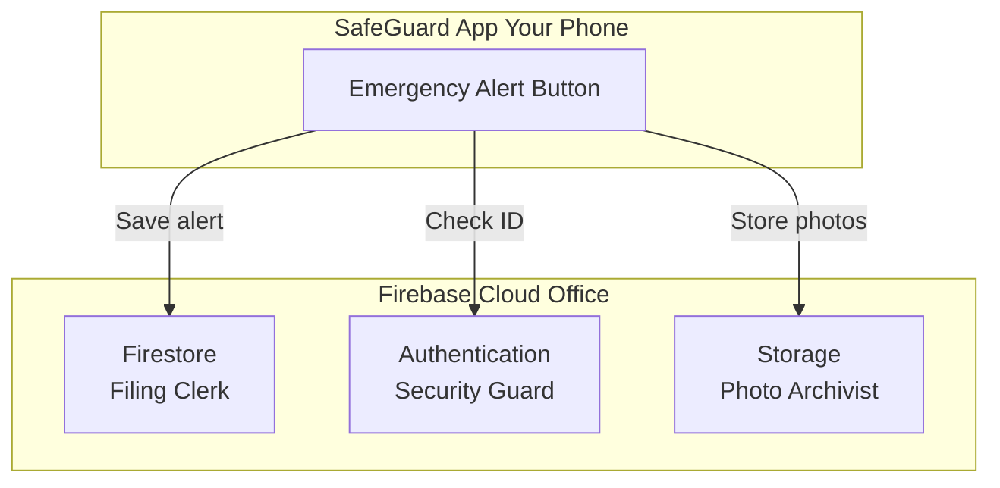

**The Three Key Staff Members:**

1. **Firestore** - The filing clerk who organizes all your emergency alerts, user profiles, and location data in filing cabinets (database tables)
2. **Authentication** - The security guard who checks IDs at the door and makes sure only authorized users can log in
3. **Storage** - The photo archivist who keeps photos and videos of incidents safe

All three work together seamlessly, and they're available 24/7 without you managing any servers!

## Setting Up Firebase in SafeGuard

Before we can use Firebase's services, we need to connect our Flutter app to Firebase. Let's look at how SafeGuard does this.

### Step 1: Adding Firebase to Your App

In the `pubspec.yaml` file, you'll see these dependencies:

```yaml
dependencies:
  firebase_core: ^2.15.1
  firebase_auth: ^4.7.3
  cloud_firestore: ^4.8.5
  firebase_storage: ^11.2.6
```

**What each package does:**

- `firebase_core` - The master key that unlocks all Firebase services
- `firebase_auth` - Handles user login and registration
- `cloud_firestore` - The database for storing alerts and data
- `firebase_storage` - Saves photos and videos to the cloud

Think of `firebase_core` as the front door to the Firebase office building. The other three are specific departments you can visit once you're inside.

### Step 2: Initializing Firebase

Before using Firebase, you must "wake it up" when your app starts. Here's what that looks like:

```dart
import 'package:firebase_core/firebase_core.dart';

void main() async {
  await Firebase.initializeApp();
  runApp(SafeGuardApp());
}
```

**What's happening:**

- Line 1: Import the Firebase core package
- Line 4: Initialize Firebase (connect to the cloud office)
- Line 5: Start the SafeGuard app

The `await` keyword means "wait for Firebase to finish setting up before continuing." You only do this once when the app starts.

**Example output:** When this runs, Firebase connects to Google's servers and sets up your app's connection. No visible output, but now all Firebase services are ready!

## Service 1: Firestore - Your Cloud Database

Firestore is like a **giant, organized filing cabinet** in the cloud. Instead of storing data on the user's phone (which disappears if they uninstall the app), you store it in Firestore where it's safe, backed up, and accessible from any device.

### How Firestore Organizes Data

Firestore uses a simple structure:

```
Collections (filing cabinet drawers)
  └── Documents (file folders)
       └── Fields (pieces of paper with info)
```

For SafeGuard, we might have:

```
users (collection)
  └── user123 (document)
       ├── name: "Sarah Johnson"
       ├── phone: "555-0123"
       └── role: "citizen"

emergencies (collection)
  └── alert456 (document)
       ├── location: "123 Main St"
       ├── timestamp: "2026-10-16 3:30 PM"
       └── status: "active"
```

### Saving Data to Firestore

Let's say a user presses the emergency button. Here's how SafeGuard saves that alert:

```dart
import 'package:cloud_firestore/cloud_firestore.dart';

// Create a reference to Firestore
FirebaseFirestore db = FirebaseFirestore.instance;

// Save emergency alert
await db.collection('emergencies').add({
  'location': 'Latitude: 37.7749, Longitude: -122.4194',
  'timestamp': DateTime.now(),
  'userId': 'user123',
  'status': 'active'
});
```

**Line-by-line:**

- Line 4: Get a connection to the Firestore database
- Line 7-12: Create a new document in the "emergencies" collection with emergency details

**Example output:** A new emergency alert is saved to the cloud! Police officers monitoring the database see it instantly.

### Reading Data from Firestore

Now let's retrieve emergency alerts for police officers to see:

```dart
// Get all active emergencies
QuerySnapshot snapshot = 
    await db.collection('emergencies')
           .where('status', isEqualTo: 'active')
           .get();

// Print each emergency
for (var doc in snapshot.docs) {
  print('Emergency at: ${doc['location']}');
}
```

**What this does:**

- Line 2-5: Fetch all documents where status = "active"
- Line 8-10: Loop through results and print locations

**Example output:**
```
Emergency at: Latitude: 37.7749, Longitude: -122.4194
Emergency at: Latitude: 40.7128, Longitude: -74.0060
```

### Real-Time Updates

Here's where Firestore gets magical! Instead of repeatedly checking for new alerts (like refreshing a webpage), Firestore can **push updates** to your app automatically:

```dart
// Listen for real-time updates
db.collection('emergencies')
  .where('status', isEqualTo: 'active')
  .snapshots()
  .listen((snapshot) {
    print('New alert received!');
    // Update the UI automatically
  });
```

**What happens:**

When someone creates a new emergency alert anywhere in the world, this code instantly receives a notification and updates the police officer's screen. No refresh button needed!

**Example output:** A police officer's app shows a new alert the moment it's created, without any action on their part.

## Service 2: Authentication - The Security Guard

Firebase Authentication handles user logins so you don't have to build your own password system. It's like having a professional security guard who:

- Checks user credentials
- Issues secure access badges (tokens)
- Remembers who's logged in
- Resets passwords safely

### Creating a New User Account

When someone installs SafeGuard for the first time, they register:

```dart
import 'package:firebase_auth/firebase_auth.dart';

FirebaseAuth auth = FirebaseAuth.instance;

// Register new user
UserCredential result = await auth.createUserWithEmailAndPassword(
  email: 'officer.smith@police.gov',
  password: 'securePassword123'
);
```

**What happens:**

- Line 6-9: Firebase creates a secure account with the email and password
- Firebase automatically hashes (encrypts) the password - you never see it in plain text!

**Example output:** User created successfully! Firebase returns a `UserCredential` object with their unique user ID.

### Logging In

When a user opens the app, they log in:

```dart
// Log in existing user
UserCredential result = await auth.signInWithEmailAndPassword(
  email: 'officer.smith@police.gov',
  password: 'securePassword123'
);

User? user = result.user;
print('Logged in as: ${user?.email}');
```

**Example output:**
```
Logged in as: officer.smith@police.gov
```

Firebase checks the password behind the scenes. If it's wrong, it throws an error.

### Checking Who's Logged In

At any time, you can check if someone is logged in:

```dart
User? currentUser = auth.currentUser;

if (currentUser != null) {
  print('User ID: ${currentUser.uid}');
  print('Email: ${currentUser.email}');
} else {
  print('No one is logged in');
}
```

**Example output:**
```
User ID: abc123xyz
Email: officer.smith@police.gov
```

This `uid` (unique identifier) is what you use to link data in Firestore to specific users!

## Service 3: Storage - The Photo Archive

Firebase Storage is like a **massive photo album** in the cloud. When users capture incident photos or videos, SafeGuard uploads them here.

### Uploading a Photo

Let's say a user takes a photo of an emergency situation:

```dart
import 'package:firebase_storage/firebase_storage.dart';
import 'dart:io';

// Reference to Storage
FirebaseStorage storage = FirebaseStorage.instance;

// Upload photo
File photo = File('/path/to/photo.jpg');
await storage.ref('incidents/photo123.jpg').putFile(photo);
```

**What's happening:**

- Line 8: Get the photo file from the device
- Line 9: Upload it to the path `incidents/photo123.jpg` in Firebase Storage

**Example output:** The photo is uploaded to Google's cloud servers and is now accessible from anywhere!

### Downloading/Viewing a Photo

To show that photo to a police officer:

```dart
// Get download URL
String url = await storage
    .ref('incidents/photo123.jpg')
    .getDownloadURL();

print('Photo URL: $url');
// Use this URL to display the image
```

**Example output:**
```
Photo URL: https://firebasestorage.googleapis.com/v0/b/safeguard/...
```

You can use this URL in an image widget to display the photo in your app!

## How It All Works Together: A Complete Example

Let's walk through what happens when a user sends an emergency alert with a photo:

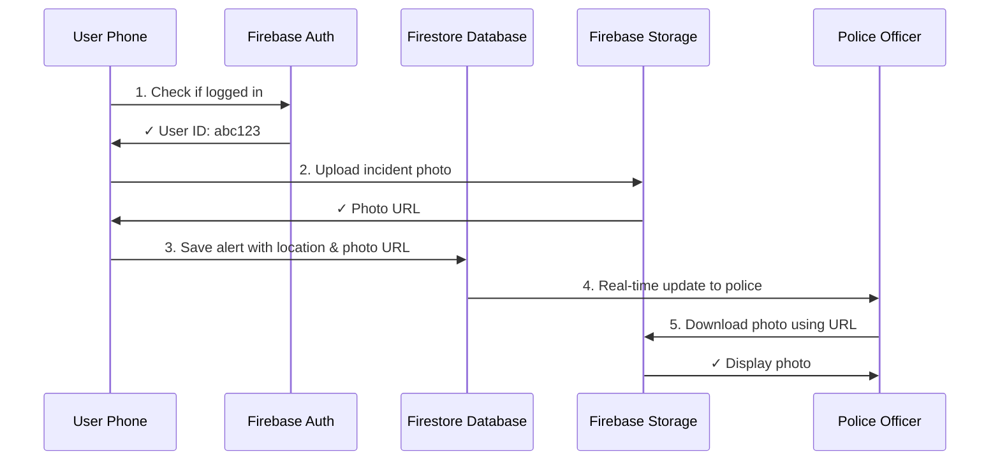

**Step-by-step:**

1. **Authentication**: Check who's sending the alert (their user ID)
2. **Storage**: Upload the incident photo and get a URL
3. **Firestore**: Save the emergency alert with location, timestamp, user ID, and photo URL
4. **Real-time Sync**: Firestore automatically notifies the police officer's app
5. **Display**: Police officer's app downloads the photo from Storage using the URL

All of this happens in seconds!

## Under the Hood: How Firebase Communicates

When you call `db.collection('emergencies').add(...)`, what really happens?

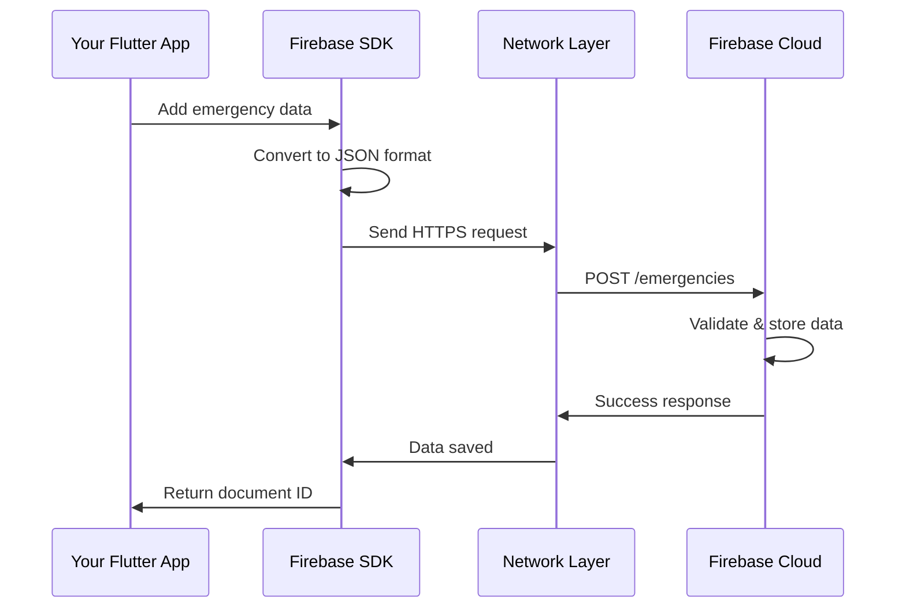

**What happens:**

1. Your app calls a Firebase method
2. The Firebase SDK (package you installed) converts your Dart data to JSON format
3. It sends a secure HTTPS request to Google's servers
4. Firebase validates the data and stores it in the database
5. Firebase sends back a confirmation
6. Your app receives a document ID confirming the save

All the networking, security, and server management happens automatically!

## Connecting Firebase to the Plugin System

You might notice in `windows/flutter/generated_plugin_registrant.cc` that Firebase plugins are registered:

```cpp
#include <firebase_core/firebase_core_plugin_c_api.h>
#include <firebase_auth/firebase_auth_plugin_c_api.h>
#include <cloud_firestore/cloud_firestore_plugin_c_api.h>

void RegisterPlugins(flutter::PluginRegistry* registry) {
  FirebaseCorePluginCApiRegisterWithRegistrar(
      registry->GetRegistrarForPlugin("FirebaseCorePluginCApi"));
  FirebaseAuthPluginCApiRegisterWithRegistrar(
      registry->GetRegistrarForPlugin("FirebaseAuthPluginCApi"));
  // ... more registrations
}
```

**What this means:**

Remember from [Chapter 1: Flutter Cross-Platform Framework](01_flutter_cross_platform_framework.md) how each platform has bridge code? These lines register Firebase plugins with the Windows platform. Similar code exists for Android, iOS, and Linux.

When your Dart code calls `Firebase.initializeApp()`, it goes through these registered plugins to connect to the native platform's network layer. We'll learn more about this plugin registration system in [Chapter 3: Plugin Registration System](03_plugin_registration_system.md).

## Security: How Firebase Keeps Data Safe

You might wonder: "Can anyone read my emergency alerts?"

Firebase uses **security rules** to protect data. Here's a simple example:

```
// Only authenticated users can read emergencies
// Only the user who created an alert can delete it
match /emergencies/{alertId} {
  allow read: if request.auth != null;
  allow delete: if request.auth.uid == resource.data.userId;
}
```

This is written in Firebase's security language (not Dart). It means:
- Anyone logged in can read emergency alerts
- Only the person who created an alert can delete it

These rules run on Firebase's servers, so hackers can't bypass them!

## What You've Learned

In this chapter, you discovered:

1. **The Problem**: Apps need a backend for data storage, user authentication, and file management
2. **Firebase Solution**: A cloud platform that provides all backend services without managing servers
3. **Three Main Services**:
   - **Firestore**: Database for storing emergency alerts and user data
   - **Authentication**: Secure login system for users
   - **Storage**: Cloud storage for photos and videos
4. **Real-time Features**: Firestore pushes updates instantly to all connected devices
5. **How They Work Together**: Auth identifies users, Storage saves photos, Firestore organizes everything
6. **Communication**: Firebase SDK handles all the networking and security automatically

Firebase is the invisible force that makes SafeGuard's emergency features possible. It ensures that when someone presses that emergency button, the alert reaches police officers instantly, no matter where they are.

## What's Next?

You now understand how Flutter provides cross-platform capabilities and Firebase powers the backend. But there's one more piece of the puzzle: how do all those Firebase packages and other plugins (like GPS tracking) actually connect to Flutter?

In [Chapter 3: Plugin Registration System](03_plugin_registration_system.md), you'll discover the glue that binds Dart code to native platform features. You'll learn how the app registers plugins like `geolocator`, `firebase_core`, and `cloud_firestore` so they work seamlessly on Windows, Android, iOS, and Linux. This is the magic that makes everything we've learned come together!


# Chapter 3: Plugin Registration System

## Connecting Flutter to the Real World

In [Chapter 2: Firebase Backend Services](02_firebase_backend_services.md), you learned how Firebase powers SafeGuard's cloud features - storing emergency alerts, authenticating users, and managing photos. Your Flutter app can save data to Firestore, but have you ever wondered **how your Dart code actually talks to Firebase's native libraries?**

And it's not just Firebase. SafeGuard also needs to:
- Access your phone's **GPS** to get location
- Use the **camera** to take incident photos
- Send **SMS messages** in emergencies
- Display **maps** on the screen

All these features require **native device hardware** - things built into Android, iOS, Windows, or Linux operating systems. But here's the catch: **Flutter runs in its own isolated environment**, like a secure bubble. It can't directly access your camera or GPS.

This is where the **Plugin Registration System** comes in - the invisible phone directory that connects Flutter to native features.

## The Problem: Flutter's Isolated World

Imagine Flutter as a person working in a soundproof office. They want to order lunch, but they can't leave the office or shout through the walls. They need a phone system to call restaurants.

```mermaid
graph LR
    subgraph "Flutter's Isolated Bubble"
        A[Your Dart Code<br/>"I need GPS location!"]
    end
    
    subgraph "Native Platform World"
        B[Android GPS]
        C[iOS Location Services]
        D[Windows Location API]
    end
    
    A -.->|??? How to connect?| B
    A -.->|??? How to connect?| C
    A -.->|??? How to connect?| D
```

**The problem:** Your Dart code runs in Flutter's engine (written in C++), which is separate from the native platform code. When you write:

```dart
Position position = await Geolocator.getCurrentPosition();
```

How does Flutter know to call Android's GPS system, or iOS's location services, or Windows's location API? They're all different!

**The solution:** The Plugin Registration System acts as a **phone directory** with **automated receptionists** that route your calls to the right native code.

## What is the Plugin Registration System?

The Plugin Registration System is like a **company phone directory** that lists all available services and their extension numbers. When Flutter needs to call a native feature, it looks up the service in this directory and gets connected.

Here's the analogy:

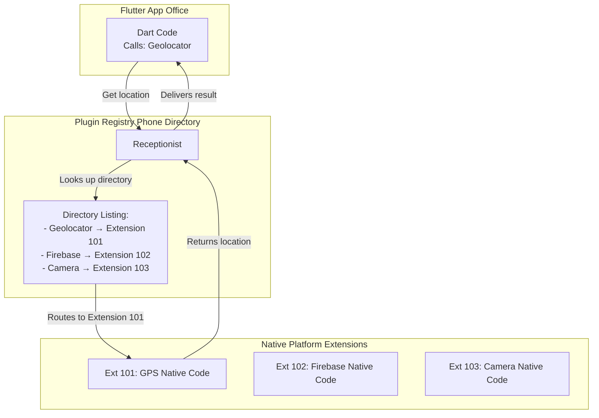

**Key parts:**

1. **Your Dart Code** - Makes requests like "get GPS location"
2. **Plugin Registry** - The phone directory that knows which extension to dial
3. **Receptionist** - The automated system that routes calls
4. **Native Code** - The actual platform-specific implementation

Without this system, when you call `Geolocator.getCurrentPosition()`, Flutter wouldn't know which native GPS code to execute!

## Where Plugin Registration Happens

Remember from [Chapter 1: Flutter Cross-Platform Framework](01_flutter_cross_platform_framework.md) that each platform has its own folder? Each platform has a special file called `generated_plugin_registrant` that acts as the phone directory.

```
Public_Safety_Application/
├── android/
│   └── app/src/main/.../GeneratedPluginRegistrant.java
├── ios/
│   └── Runner/GeneratedPluginRegistrant.m
├── windows/
│   └── flutter/generated_plugin_registrant.cc  ← Windows directory
├── linux/
│   └── flutter/generated_plugin_registrant.cc  ← Linux directory
└── lib/
    └── main.dart  ← Your Dart code
```

Each file is in that platform's native language:
- **Android**: Java
- **iOS**: Objective-C
- **Windows/Linux**: C++

Let's look at how these directories work!

## Looking at Windows Plugin Registration

Open `windows/flutter/generated_plugin_registrant.cc` and you'll see:

```cpp
#include <cloud_firestore/cloud_firestore_plugin_c_api.h>
#include <firebase_auth/firebase_auth_plugin_c_api.h>
#include <firebase_core/firebase_core_plugin_c_api.h>
#include <geolocator_windows/geolocator_windows.h>
```

**What this means:**

These `#include` lines are like importing phone books. Each line says "add this service to our directory":

- `cloud_firestore` - Directory entry for Firestore database
- `firebase_auth` - Directory entry for Firebase authentication  
- `firebase_core` - Directory entry for Firebase core services
- `geolocator_windows` - Directory entry for Windows GPS

Now look at the registration function:

```cpp
void RegisterPlugins(flutter::PluginRegistry* registry) {
  CloudFirestorePluginCApiRegisterWithRegistrar(
      registry->GetRegistrarForPlugin("CloudFirestorePluginCApi"));
  GeolocatorWindowsRegisterWithRegistrar(
      registry->GetRegistrarForPlugin("GeolocatorWindows"));
}
```

**Line-by-line:**

- Line 1: Create a function called `RegisterPlugins` that takes the plugin directory (`registry`)
- Line 2-3: Add Firestore to the directory with extension name "CloudFirestorePluginCApi"
- Line 4-5: Add Geolocator to the directory with extension name "GeolocatorWindows"

This is like the receptionist writing down in the phone directory:
- "When someone asks for Firestore, connect them to `CloudFirestorePluginCApi`"
- "When someone asks for Geolocator, connect them to `GeolocatorWindows`"

**Example output:** When SafeGuard starts on Windows, this function runs once and builds the complete phone directory of all available plugins.

## Looking at Linux Plugin Registration

Now let's see `linux/flutter/generated_plugin_registrant.cc`:

```cpp
#include <file_selector_linux/file_selector_plugin.h>
#include <url_launcher_linux/url_launcher_plugin.h>

void fl_register_plugins(FlPluginRegistry* registry) {
  g_autoptr(FlPluginRegistrar) file_selector_linux_registrar =
      fl_plugin_registry_get_registrar_for_plugin(registry, "FileSelectorPlugin");
  file_selector_plugin_register_with_registrar(file_selector_linux_registrar);
}
```

**What's different?**

Linux uses slightly different naming (`fl_register_plugins` instead of `RegisterPlugins`), but it's the same concept! It's registering:

- `file_selector_linux` - For picking files
- `url_launcher_linux` - For opening web links

Notice Linux has different plugins than Windows! That's because:
- Windows already has Firebase plugins registered (we saw that above)
- Linux has file selector and URL launcher
- Each platform registers **only the plugins it needs**

The registration files are **generated automatically** by Flutter based on what's in your `pubspec.yaml` file!

## How Plugins Get Added: The pubspec.yaml File

Remember this file from earlier chapters? Let's look at it again:

```yaml
dependencies:
  geolocator: ^10.0.0
  firebase_core: ^2.15.1
  cloud_firestore: ^4.8.5
  camera: ^0.11.0+1
```

**What happens when you add a plugin:**

1. You write `geolocator: ^10.0.0` in `pubspec.yaml`
2. You run `flutter pub get` (downloads the plugin)
3. Flutter **automatically** updates `generated_plugin_registrant.cc` files
4. The new plugin appears in the directory on next build!

It's like ordering a new phone line - you request it, and the phone company (Flutter) automatically adds it to the directory.

**Example:** When SafeGuard's developers added the camera plugin, Flutter automatically generated registration code like:

```cpp
#include <camera_windows/camera_windows_plugin.h>

CameraWindowsPluginRegisterWithRegistrar(
    registry->GetRegistrarForPlugin("CameraWindowsPlugin"));
```

## The Complete Registration Process

Let's walk through what happens when SafeGuard starts up:

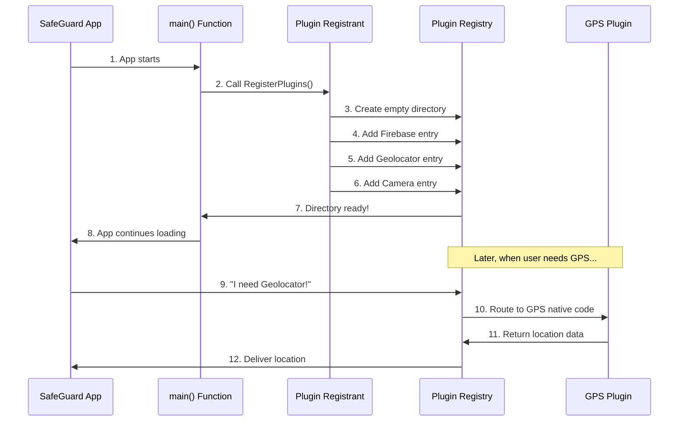

**Step-by-step explanation:**

1. **App starts**: SafeGuard launches on Windows
2. **Call RegisterPlugins()**: The main program calls the registration function
3. **Create directory**: An empty plugin directory is created in memory
4-6. **Add entries**: Each plugin is added to the directory one by one
7. **Directory ready**: All plugins are now registered and ready to use
8. **App continues**: SafeGuard finishes loading (shows login screen, etc.)
9-12. **Later usage**: When someone requests GPS, the directory routes to the correct native code

This happens **once** when the app starts, before any Dart code runs!

## Looking Inside: How a Plugin Call Works

Now let's zoom into step 9-12 from above. When your Dart code calls:

```dart
Position position = await Geolocator.getCurrentPosition();
```

Here's the detailed journey:

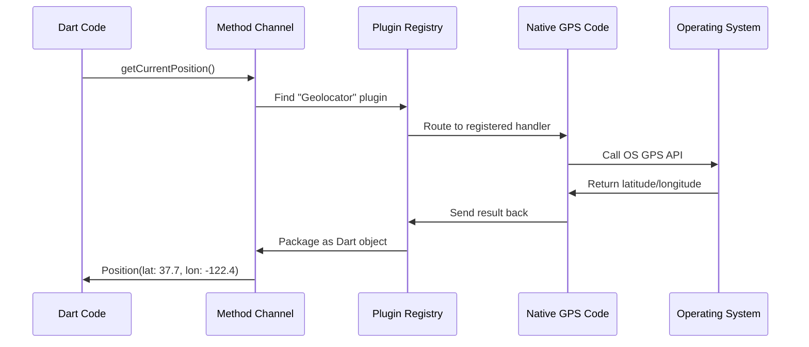

**Detailed steps:**

1. **Dart Code**: You call `getCurrentPosition()` in your Flutter code
2. **Method Channel**: Geolocator plugin uses a "method channel" (communication bridge) to send a message
3. **Plugin Registry**: The registry looks up "Geolocator" in its directory
4. **Route to Handler**: Registry connects to the registered `GeolocatorWindows` native code
5. **Call OS API**: Native code calls Windows's actual GPS API (written in C++)
6. **OS Returns Data**: Windows returns latitude and longitude
7-8. **Send Back**: Data travels back through the registry and channel to your Dart code

**Example output:**
```dart
Position(latitude: 37.7749, longitude: -122.4194, timestamp: 2026-10-16 3:30 PM)
```

All of this happens in milliseconds!

## Method Channels: The Phone Lines

The "method channel" we mentioned is Flutter's communication system. Think of it as the actual phone line connecting two offices:

```dart
// In the Geolocator plugin's Dart code
const MethodChannel _channel = MethodChannel('flutter.baseflow.com/geolocator');

Future<Position> getCurrentPosition() async {
  final position = await _channel.invokeMethod('getCurrentPosition');
  return Position.fromMap(position);
}
```

**What happens:**

- Line 2: Create a method channel with a unique name (like a phone number)
- Line 5: Send a message called `'getCurrentPosition'` through the channel
- Line 6: Convert the response back to a `Position` object

On the native side (Windows C++), there's matching code:

```cpp
void GeolocatorWindows::HandleMethodCall(MethodCall call) {
  if (call.method_name() == "getCurrentPosition") {
    // Call Windows GPS API
    // Send result back through the channel
  }
}
```

The plugin registry ensures that when Dart sends a message on the `geolocator` channel, it reaches this C++ code!

## Why Files Are Called "Generated"

Notice the files are named `generated_plugin_registrant.cc`? The word **generated** means Flutter creates them automatically. You should **never** edit these files manually!

Here's what happens:

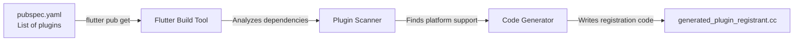

**Process:**

1. You list plugins in `pubspec.yaml`
2. Run `flutter pub get` to download them
3. Flutter's build tool scans which platforms each plugin supports
4. Flutter generates registration code for each platform
5. Files are created/updated automatically

**Example:** When SafeGuard added `firebase_messaging: ^14.7.10`, Flutter automatically added this to the Windows registrant:

```cpp
#include <firebase_messaging/firebase_messaging_plugin_c_api.h>

FirebaseMessagingPluginCApiRegisterWithRegistrar(
    registry->GetRegistrarForPlugin("FirebaseMessagingPluginCApi"));
```

No manual typing needed!

## Platform-Specific Plugins

Some plugins only work on certain platforms. Look at `pubspec.yaml`:

```yaml
dependencies:
  flutter_phone_direct_caller: ^2.1.1  # Only Android/iOS
  geolocator: ^10.0.0                  # All platforms
```

The `flutter_phone_direct_caller` plugin (for making emergency calls) only works on mobile phones because desktop computers can't make calls!

So the registration files differ:

- **Android registrant**: Includes `flutter_phone_direct_caller`
- **Windows registrant**: Does NOT include `flutter_phone_direct_caller`

Flutter is smart - it only registers plugins that the current platform supports!

## Common Plugins in SafeGuard

Let's look at the main plugins SafeGuard uses and what they do:

| Plugin Name | What It Does | Platforms |
|------------|--------------|-----------|
| `geolocator` | Gets GPS location | All |
| `firebase_core` | Connects to Firebase | All |
| `camera` | Takes photos/videos | All |
| `url_launcher` | Opens web links | All |
| `flutter_phone_direct_caller` | Makes phone calls | Mobile only |
| `permission_handler` | Asks for permissions | All |

Each of these appears in the `generated_plugin_registrant` files on the platforms where they're supported.

For example, on Windows:

```cpp
// From windows/flutter/generated_plugin_registrant.cc
GeolocatorWindowsRegisterWithRegistrar(...)
FirebaseCorePluginCApiRegisterWithRegistrar(...)
PermissionHandlerWindowsPluginRegisterWithRegistrar(...)
UrlLauncherWindowsRegisterWithRegistrar(...)
```

No phone dialer because Windows can't make calls!

## The Registry in Memory

When `RegisterPlugins()` runs, what does the registry look like in memory?

```
Plugin Registry (In Memory)
┌─────────────────────────────────────────┐
│ Plugin Name          │ Native Handler   │
├─────────────────────────────────────────┤
│ CloudFirestore       │ 0x7FF1234 ───────┼──> Firebase native code
│ FirebaseAuth         │ 0x7FF5678 ───────┼──> Auth native code
│ Geolocator           │ 0x7FF9ABC ───────┼──> GPS native code
│ Camera               │ 0x7FFDEF0 ───────┼──> Camera native code
│ UrlLauncher          │ 0x7FF1357 ───────┼──> URL native code
└─────────────────────────────────────────┘
```

Each plugin name maps to a memory address (like `0x7FF1234`) where the native code lives. When Dart asks for "Geolocator", the registry looks up its address and routes the call there.

It's like a phone directory where each name has an extension number!

## Connecting to Previous Chapters

Remember from [Chapter 2: Firebase Backend Services](02_firebase_backend_services.md) when we wrote:

```dart
await Firebase.initializeApp();
```

This only works because:

1. `firebase_core` is listed in `pubspec.yaml`
2. Flutter generated registration code in `generated_plugin_registrant.cc`
3. The registration code added Firebase to the plugin directory
4. Now when `Firebase.initializeApp()` is called, it can find the native Firebase code!

Without the plugin registration system, Firebase would have no way to connect to the native platform!

Similarly, GPS from [Chapter 1: Flutter Cross-Platform Framework](01_flutter_cross_platform_framework.md):

```dart
Position position = await Geolocator.getCurrentPosition();
```

This works because `geolocator` was registered in the plugin directory!

## What Happens If Registration Fails?

If you forget to run `flutter pub get` after adding a plugin, the registration code won't be generated. Here's what happens:

```dart
// Try to use an unregistered plugin
await Geolocator.getCurrentPosition();
```

**Error message:**
```
MissingPluginException: No implementation found for method getCurrentPosition
```

This error means: "I looked in the plugin directory, but there's no entry for Geolocator!"

**Solution:** Run `flutter pub get` to regenerate the registrant files.

## What You've Learned

In this chapter, you discovered:

1. **The Problem**: Flutter runs in isolation and can't directly access native device features
2. **The Solution**: Plugin Registration System acts as a phone directory connecting Dart code to native code
3. **How It Works**:
   - Each platform has a `generated_plugin_registrant` file
   - This file registers all plugins when the app starts
   - Plugins are added based on what's in `pubspec.yaml`
   - Flutter automatically generates these files
4. **Method Channels**: The communication bridges between Dart and native code
5. **Platform Differences**: Some plugins work on all platforms, others are platform-specific
6. **The Registry**: An in-memory directory mapping plugin names to native code handlers

The plugin registration system is the invisible glue that makes Flutter's cross-platform magic work. Without it, Firebase, GPS, cameras, and all native features would be unreachable from your Dart code!

## Conclusion

You've now completed your journey through SafeGuard's core architecture:

1. [Chapter 1: Flutter Cross-Platform Framework](01_flutter_cross_platform_framework.md) - How one codebase runs on all platforms
2. [Chapter 2: Firebase Backend Services](02_firebase_backend_services.md) - How cloud services power real-time features  
3. **Chapter 3: Plugin Registration System** - How Flutter connects to native device features

Together, these three pieces work in harmony:

- **Flutter** provides the cross-platform foundation
- **Firebase** handles cloud data and authentication
- **Plugin Registration** bridges Flutter to native hardware and services

With this understanding, you can now see how SafeGuard achieves its mission: when a user presses the emergency button, Flutter's UI responds, Firebase stores the alert in the cloud, and the GPS plugin (registered through the plugin system) accesses the device's location hardware to pinpoint where help is needed.

You've gained foundational knowledge of how modern mobile and desktop apps work. Whether you're building safety apps, social networks, or games, these same patterns apply. Welcome to the world of app development!

